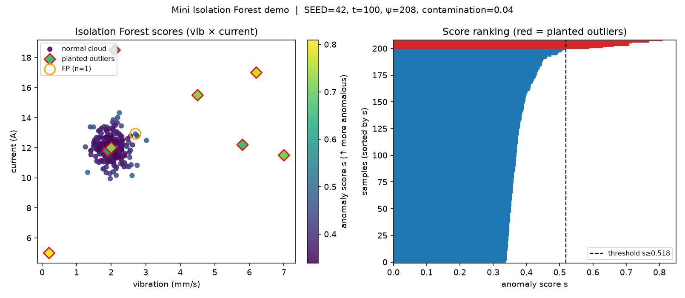

# 孤立森林（Isolation Forest）：用随机切分把异常「隔离」出来

**孤立森林（Isolation Forest，简称 iForest）**是无监督、多变量的异常检测方法：不建模「正常长什么样」，而是利用异常「又少又怪」的性质，用随机轴对齐切分把它们更快地切成单点。相对盯单变量漂移的 EWMA、做状态平滑的卡尔曼，它机制完全不同，更适合产线多传感器联合判断「这帧像不像野点」。

配套演示脚本见交付包 `code/2026-10-09-isolation_forest.py`  

## 是什么

Liu、Ting、Zhou 在 ICDM 2008 提出孤立森林（Isolation Forest）：不先拟合正常密度或距离轮廓，而是建一丛**隔离树（isolation tree，iTree）**。每棵树反复随机选一个特征，再在该特征当前区间内随机选切分点，把样本二分，直到点被单独隔离，或树高触顶。异常因为样本少、属性值离群，往往更早被切出来，平均路径更短；正常点挤在云里，要切很多次才分开。

两阶段流程：

1. **训练**：从数据中无放回子采样，建 \(t\) 棵 iTree（论文默认 \(t=100\)，子采样大小 \(\psi=256\)）。
2. **评分**：把待测点送进每棵树，量路径长度 \(h(x)\)，对森林取期望 \(E[h(x)]\)，再归一化成异常分数 \(s(x,\psi)\)。\(s\) 越接近 1 越像异常；接近 0.5 表示「和平均路径差不多」；明显小于 0.5 更像正常。

对照 scikit-learn 的 `IsolationForest`：接口里 `contamination`（污染率，即假定异常占比）用来定决策阈值；`score_samples` 返回的是论文分数的相反数（越低越异常），和本文演示里直接打印的论文分数 \(s\) 方向相反，读文档时不要混。演示用 numpy 自实现迷你版（不依赖 scikit-learn），公式与论文一致，便于把树和路径看透。

## 怎么工作

### 随机特征切分

在当前节点的样本子集 \(X'\) 上：

1. 均匀随机选一个特征 \(q\)；
2. 在该特征于 \(X'\) 上的 \([\min,\max]\) 内均匀随机选切分值 \(p\)；
3. \(x_q < p\) 走左子树，否则走右子树；
4. 直到 \(|X'|=1\)、特征全相同，或深度达到高度上限 \(l=\lceil\log_2\psi\rceil\)（大约等于平均树高，故意不把正常点全隔离完）。

轴对齐的随机切分很糙，但糙得有用：离群点只要有一个坐标落在稀疏区间，就很容易被一刀切开。

### 路径长度与异常分数

**路径长度** \(h(x)\)：从根走到终止外节点经过的边数。若因高度上限停在仍含多个样本的叶子，论文用二叉搜索树（Binary Search Tree，BST）不成功查找的平均路径长度 \(c(\cdot)\) 给未展开子树加一项补偿：

\[
c(n)=\begin{cases}
2H(n-1)-\dfrac{2(n-1)}{n} & n>2 \\
1 & n=2 \\
0 & n<2
\end{cases}
\]

其中调和数 \(H(i)\approx\ln i+\gamma\)，\(\gamma\approx 0.5772156649\)（欧拉常数）。\(c(n)\) 就是「大小为 \(n\) 的 iTree 上，外节点终止的期望路径长度」。

异常分数（Liu et al. 原文）：

\[
s(x,\psi)=2^{-\,E[h(x)]\,/\,c(\psi)}
\]

含义可以对照三条极限：

- \(E[h(x)]\to 0\) 则 \(s\to 1\)：极短路径，几乎肯定是异常；
- \(E[h(x)]\to c(\psi)\) 则 \(s\to 0.5\)：和平均一样长，没有特别异常的信号；
- \(E[h(x)]\) 很大则 \(s\to 0\)：很难隔离，像正常点。

**为什么稀疏异常更容易被隔离？** 两层直觉叠在一起。第一，异常少，随机二分时它们所在一侧更容易很快变成单点。第二，属性值「不同」，切分平面更早把它们和主体云撕开。论文 Figure 1 的高斯例子里，正常点平均要十来刀，离群点四五刀就切开；树数增多后期望路径会稳住。

### 小例子（与脚本一致）

二维玩具：5 个正常点挤在原点附近，1 个异常在 \((8,8)\)。参数：`n_estimators=50`，\(\psi=6\)，`random_state=7`。

\[
c(6)=2(\ln 5+\gamma)-2\cdot5/6\approx 2.7066
\]

脚本输出：

| 点 | 坐标 | \(E[h]\) | \(s\) |
|---|---|---|---|
| pt0–pt4（正常） | 原点附近 | 约 3.1–3.8 | 约 0.38–0.45 |
| pt5（异常） | \((8,8)\) | **1.060** | **0.762** |

异常路径大约是正常点的三分之一，分数抬到 0.76 一带；正常点簇在 0.4 上下，贴近「\(s\approx0.5\) 表示没有突出异常」的论文判读。

### contamination（污染率）阈值

论文本身按 \(s\) 排序，取出「最异常」的若干点。工程里常要二值告警：scikit-learn 用 **contamination**（污染率）表示「训练数据里异常大概占多少」，据此定阈值，使大约该比例的训练点被标成异常。演示取 `contamination=0.04`（208 点里约 9 个）：\(s\ge 0.5183\) 判为异常（标签 \(-1\)）。污染率估高了会多误报；估低了会漏真异常。没有可靠先验时，可以先看分数排序并做业务复核，再回头钉阈值。

## 复杂度／代价

论文给出的量级：

- **建树**：\(O(t\,\psi\log\psi)\)。默认 \(\psi=256\)、\(t=100\) 时，训练几乎不随全量 \(n\) 上涨。相对局部异常因子（Local Outlier Factor，LOF）等基于邻域密度的方法，这是关键优势。
- **推断**：\(O(n\,t\log\psi)\)，每个点走 \(t\) 棵浅树。
- **内存**：单棵满树节点数约 \(2\psi-1\)，\(\psi=256\) 时一棵不到 512 个节点，整片森林很小，适合边缘侧常驻。

和 LOF 怎么选：LOF 擅长「局部密度洼地」（全局不稀、邻域却空），但距离计算贵，高维容易塌。孤立森林线性、便宜，对「全局又少又怪」的点很灵，但对局部结构和轴对齐偏置更钝（见下文局限）。大规模多传感器要先快筛一轮时，孤立森林往往更现实。

## 应用场景

- **产线／数字孪生**：振动、电流、温度、压力等多通道同一拍拼成特征向量，抓轴承磨损、过载、冷却失效这类「联合野点」，不必先为每个通道单独定控制限。
- **传感器组漂移／卡死**：某一通道卡死在常数，或整组同时偏离标称云，孤立森林会给出高分。可以与 EWMA（单通道慢漂移）分工：孤立森林抓截面异形，EWMA 抓时间轴爬升。
- **网络与安全日志、质检图像特征**：论文与后续工程里常见的大表异常排序场景。
- **股票多特征截面**（只点一句）：把当日收益、波动、成交量相对历史分位等拼成向量，孤立森林可以标出「截面上稀奇」的交易日。它不是收益预测模型，也不替代风控规则。

## 实例 A：产线三传感器联合异常（可复现演示）

设定（脚本 `SEED=42`）：

- 200 个健康点：振动 \(\sim\mathcal{N}(2.0,0.35^2)\) mm/s，电流 \(\sim\mathcal{N}(12.0,0.8^2)\) A，温度 \(\sim\mathcal{N}(55,2.5^2)\) °C；
- 8 个植入异常：单通道飙高、三通道同飞、近停机／传感器挂死、温度失控等；
- 森林：\(t=100\)，\(\psi=\min(256,208)=208\)，`contamination=0.04`。

与脚本打印一致的关键数字：

- \(c(208)\approx 9.83\)；
- 正常点平均 \(E[h]\approx 13.76\)，植入异常平均 \(E[h]\approx 5.14\)（短一半还多）；
- 分数阈值 \(s\ge 0.5183\)；检出 9 个异常：**8 个植入全部命中（真正例 TP＝8）**，另有 1 个误报（假正例 FP）：`idx=138`，振动 2.70、电流 12.92、温度 49.01，\(s=0.5183\)（刚好卡在阈值上，属于健康云边缘、温度略偏低的样本）；
- 植入点最高分：`idx=204` 近停机姿态 \(s=0.809\)；联合故障 `idx=203` \(s=0.769\)；其余植入点也全部 \(s\ge 0.588\)。

左图是振动×电流平面上的分数着色（红边菱形为植入点）；右图是全体按 \(s\) 排序的条形图，红色为植入异常，虚线为阈值。温度异常在二维投影里不一定「看起来远」，但三维特征上路径已经变短。这正是多变量相对单通道阈值的价值。

## 实例 B：股票多特征异动／传感器组漂移（点到为止）

同一套方法可以换特征定义。例如把「近 20 日收益、实现波动、成交量相对中位数的倍数」做成三维向量，对交易日截面跑孤立森林，高 \(s\) 表示该日在特征空间里像稀有组合（暴涨暴跌叠天量之类），只作异动提示，不给出买卖方向。产线上则可以把「最近 \(k\) 窗各通道均值／斜率」拼成组漂移特征：整组缓慢平移时，EWMA 更敏感；某一拍突然变成从未见过的组合时，孤立森林更直接。二者互补，不要互相顶替。

## 局限

1. **高维噪声特征**：维数很高且大量无关坐标时，随机切到信息维的概率下降，分数区分度变差。论文建议配合峰度（kurtosis）等做特征筛选；工程上更常见的是先降维，或只保留物理相关通道。
2. **全局「又少又怪」假设**：对「局部密度异常但全局并不稀」的点，LOF 一类局部方法往往更合适；孤立森林可能放过它们。
3. **轴对齐偏置**：切分总是平行于坐标轴，分数等高线容易出现矩形伪影。Hariri 等人的扩展孤立森林（Extended Isolation Forest）改用随机超平面切分，可以减轻该偏置（本文演示仍用经典轴对齐版）。
4. **概念漂移（concept drift）**：产线换刀、换料、季节工况变了，旧森林里的「正常云」会过期。需要定期用新的健康窗重训，或做滑动窗口／半在线变体；不能训一次吃一年。
5. **掩盖（masking）与淹没／误伤（swamping）**：异常成团太密，或正常点贴异常太近，隔离都会变难。论文强调**小样本子采样**反而有助于减轻这两种效应。这和「数据越多越好」的直觉相反，是孤立森林特有的调参习惯（\(\psi\) 不必取全量）。

## 参考文献

1. [Fei Tony Liu, Kai Ming Ting, Zhi-Hua Zhou, “Isolation Forest,” ICDM 2008.](https://cs.nju.edu.cn/zhouzh/zhouzh.files/publication/icdm08b.pdf)
2. [scikit-learn, IsolationForest documentation](https://scikit-learn.org/stable/modules/generated/sklearn.ensemble.IsolationForest.html)
3. [Isolation forest — Wikipedia](https://en.wikipedia.org/wiki/Isolation_forest)（算法与 \(c(n)\)、\(s\) 公式综述）.
4. [Fei Tony Liu, Kai Ming Ting, Zhi-Hua Zhou, “Isolation-based Anomaly Detection,” *ACM Transactions on Knowledge Discovery from Data* 6(1), 2012.](https://doi.org/10.1145/2133360.2133363)（作者 PDF：[NJU](https://cs.nju.edu.cn/zhouzh/zhouzh.files/publication/tkdd11.pdf)）
