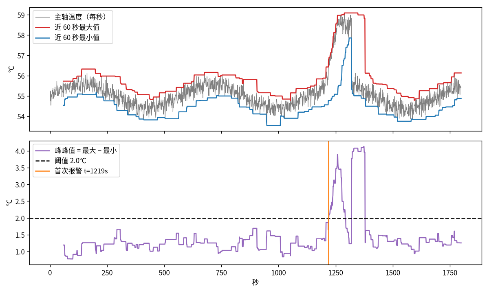

# 单调双端队列：O(n) 求滑动窗口最大值和最小值

**滑动窗口最大值（LeetCode 239，Sliding Window Maximum）**的标准解法是**单调双端队列（monotonic deque）**，代码只有十来行。产线传感器的「近 60 秒最高温」、股票的「近 20 日最高价与最低价」、游戏里的「近 N 帧最大输入」，算的都是这个东西。

配套演示脚本见交付包 `code/2026-10-13-monotonic_deque_window.py`  


## 是什么

题目：给一个长度为 \(n\) 的数组和窗口长度 \(k\)，窗口从左往右每次滑一格，输出每个窗口里的最大值。

最直接的做法是每个窗口都扫一遍取最大值，代价是 \(O(nk)\)。窗口 \(k=600\)、数据 \(n=200000\) 时，就是一亿多次比较。

单调双端队列能把总代价降到 \(O(n)\)：每个元素最多进队一次、出队一次，所以平均每个元素只花常数时间，和 \(k\) 多大无关。

这个思路在信号处理里叫**滑动最大最小滤波（running max-min filter）**。Daniel Lemire 2006 年的论文《Streaming Maximum-Minimum Filter Using No More than Three Comparisons per Element》（*Nordic Journal of Computing* 13(4), 328–339）用两个单调队列同时算最大值和最小值，证明最坏情况下每个元素不超过 3 次比较；输入单调递增或单调递减时不超过 2 次。论文还证明了在不允许延迟输出的前提下，每个元素至少需要 2 次比较。Lemire 的主页注明这个算法被 Apache Hive 采用。

## 怎么工作

### 核心观察：有些元素「永远没机会」

假设窗口里先来了 3，后来了 5。只要 5 还在窗口里，3 就不可能是最大值；而 3 比 5 先进来，也会比 5 先滑出去。所以 3 从此没有任何用处，可以直接扔掉。

把这条规则贯彻下去，队列里剩下的元素就会**从队头到队尾严格递减**。队头是当前窗口最大值，后面依次是「等前面的人走了，可能轮到自己当最大」的候补。

### 每一步三个动作

队列里存的是**下标**而不是值，因为要靠下标判断元素是否已经滑出窗口。新元素 \(x\)（下标 \(i\)）进来时：

1. **从队尾踢人**：只要队尾的值小于或等于 \(x\)，就弹出队尾。它们比 \(x\) 小，又比 \(x\) 先离开，不会再有机会。
2. **把 \(i\) 放到队尾。**
3. **从队头清过期**：如果队头下标 \(\le i-k\)，它已经不在窗口 \([i-k+1,\ i]\) 里了，弹出。每一步最多只有一个元素过期，所以判断一次就够。

窗口凑满（\(i \ge k-1\)）后，队头对应的值就是答案。

### 手算一遍

用 LeetCode 239 的官方例子：`nums = [1, 3, -1, -3, 5, 3, 6, 7]`，`k = 3`。下表里「队列」写的是值，实际存的是下标。

| i | 新元素 | 从队尾弹出 | 队列（队头→队尾） | 窗口最大 |
|---|---|---|---|---|
| 0 | 1 | 无 | [1] | 窗口未满 |
| 1 | 3 | 1 | [3] | 窗口未满 |
| 2 | -1 | 无 | [3, -1] | 3 |
| 3 | -3 | 无 | [3, -1, -3] | 3 |
| 4 | 5 | -3, -1, 3 | [5] | 5 |
| 5 | 3 | 无 | [5, 3] | 5 |
| 6 | 6 | 3, 5 | [6] | 6 |
| 7 | 7 | 6 | [7] | 7 |

输出 `[3, 3, 5, 5, 6, 7]`，和题目答案一致。

这个例子恰好没有触发「队头过期」，因为每次大值都被后来更大的值顶掉了。换一个递减序列 `[5, 4, 3, 2, 1]`、`k = 3` 就能看到过期：到 \(i=3\) 时队列是 [5, 4, 3, 2]，5 的下标 0 满足 \(0 \le 3-3\)，被从队头弹出，窗口最大变成 4。递减输入正是队列最长的情况，最多存 \(k\) 个元素。

### 想求最小值

把规则反过来：队尾的值大于或等于 \(x\) 就弹出，队列从队头到队尾递增。代码里最省事的写法是把所有数取负，调用求最大值的函数，再把结果取负。

## 复杂度和代价

- **时间**：每个下标最多入队一次、出队一次，总操作数不超过 \(2n\)，所以总时间 \(O(n)\)。单步最坏可能一次弹出很多元素（比如上表 \(i=4\) 一次弹了 3 个），但这些元素以后不会再被弹，平摊下来每步是常数。这种分析方法叫**均摊分析（amortized analysis）**，面试时最好主动说出来。
- **空间**：队列最多 \(k\) 个下标，\(O(k)\)。
- **实测**（示例脚本，`n=200000`、`k=600`、SEED=42 的正态随机数，纯 Python）：单调队列约 0.038 秒，逐窗口暴力取最大值约 1.061 秒，快约 28 倍。暴力法里 `max()` 是 C 实现，单调队列是纯 Python 循环，倍数还被压低了；\(k\) 越大差距越大。具体秒数随机器变化，量级关系不变。
- **正确性**：脚本用 2000 组随机数组和暴力法对拍，全部一致。

### 和其他做法比

| 做法 | 时间 | 说明 |
|---|---|---|
| 逐窗口暴力 | \(O(nk)\) | 最好写，\(k\) 小时完全够用 |
| 最大堆加延迟删除 | \(O(n\log n)\) | 堆顶过期时再弹，思路直观但多一个对数 |
| 线段树或稀疏表 | 建表后单次查询 \(O(\log n)\) 或 \(O(1)\) | 适合任意区间查询，不只是滑动窗口 |
| 单调双端队列 | \(O(n)\)，空间 \(O(k)\) | 窗口只往一个方向滑时的最优选择，还能流式在线处理 |

最后一行的「流式」很关键：单调队列不需要提前拿到全部数据，传感器每来一个点就更新一次，适合实时系统。

## 应用场景

1. **产线传感器的滚动最大最小与峰峰值**：近 60 秒最高温、最大振动幅值、最大电流。峰峰值（最大值减最小值）能抓「短时间内剧烈变化」。
2. **股票的唐奇安通道（Donchian Channel）**：近 20 个交易日最高价和最低价画成上下轨，突破上轨是常见的趋势跟踪信号。它的计算就是两个滑动窗口最值。
3. **数字孪生看板**：设备曲线旁边显示「近 5 分钟峰值」，每秒刷新，不用每次回扫历史数据。
4. **图像处理**：灰度形态学的膨胀和腐蚀，本质上是二维滑动最大和最小，可以按行一遍、按列一遍，各用一次单调队列。
5. **动态规划优化**：形如 \(dp[i]=\max_{i-k\le j<i} dp[j]+c_i\) 的转移，用单调队列维护窗口里的最大 \(dp[j]\)，从 \(O(nk)\) 降到 \(O(n)\)。面试里的「跳跃游戏 VI」（LeetCode 1696）就是这个套路。

## 实例：主轴温度峰峰值报警

脚本模拟一台主轴每秒一个温度点，共 1800 秒：基线 55℃，叠加缓慢正弦波动和标准差 0.25℃ 的噪声（SEED=42）。从第 1200 秒开始模拟冷却异常，60 秒内升温 3℃，再维持 60 秒后恢复。

用两个单调队列算近 60 秒的最大值和最小值，相减得峰峰值，阈值设 2.0℃：

- 正常段（前 1200 秒）峰峰值最大约 1.692℃，没有误报；
- 异常从第 1200 秒开始，**第 1219 秒首次报警**，延迟 19 秒；
- 每秒更新的代价是常数，和窗口 60 还是 600 无关。

图里能看到一个值得注意的细节：温度升到高位并保持平稳后，60 秒窗口里全是高温，峰峰值反而掉回阈值下面，直到温度回落时又冲高一次。**峰峰值只对「变化」敏感，对「稳定在异常高位」不敏感。**实际部署时要再加一条绝对值阈值（比如近 60 秒最大值超过 57℃），或者和 EWMA 残差控制图一起用。

## 代码

Python（示例脚本里的核心函数）：

```python
from collections import deque

def sliding_max(nums, k):
    dq, out = deque(), []          # dq 存下标，对应值从队头到队尾严格递减
    for i, x in enumerate(nums):
        while dq and nums[dq[-1]] <= x:
            dq.pop()               # 比 x 小且比 x 先走的元素，永远当不了最大值
        dq.append(i)
        if dq[0] <= i - k:
            dq.popleft()           # 队头已经滑出窗口
        if i >= k - 1:
            out.append(nums[dq[0]])
    return out
```

C++ 版本：

```cpp
#include <deque>
#include <vector>

std::vector<int> slidingMax(const std::vector<int>& nums, int k) {
    std::deque<int> dq;            // 存下标
    std::vector<int> out;
    for (int i = 0; i < (int)nums.size(); ++i) {
        while (!dq.empty() && nums[dq.back()] <= nums[i]) dq.pop_back();
        dq.push_back(i);
        if (dq.front() <= i - k) dq.pop_front();
        if (i >= k - 1) out.push_back(nums[dq.front()]);
    }
    return out;
}
```

## 面试时容易错的地方

1. **存值而不是存下标**：存值就没法判断谁过期，遇到重复值还会出错。
2. **`<=` 还是 `<`**：弹出条件用 `<=` 时，相等的旧元素会被新元素替换，队列严格递减；用 `<` 时相等元素都留着，队列非严格递减。两种都对，但过期判断必须靠下标，不能靠值。
3. **先清过期还是先入队**：本文先入队再清队头。也可以先清队头再入队，结果一样，只要清的条件是「下标 \(\le i-k\)」。
4. **说不清为什么是 \(O(n)\)**：内层有 `while` 不代表是 \(O(nk)\)，要讲出「每个元素最多进出各一次」。

## 延伸思考

- 窗口按时间而不是按个数（传感器采样不均匀时，窗口是「近 60 秒」而不是「近 60 个点」），过期条件怎么改；
- Lemire 论文里怎么把最大和最小两个队列合在一起省比较次数；
- 二维滑动最大值（图像膨胀）怎么拆成行和列两遍；
- 单调栈（monotonic stack）和单调队列的区别，以及「下一个更大元素」「柱状图最大矩形」这类题；
- 窗口长度可变时（比如双指针求「最大值减最小值不超过阈值的最长子数组」，LeetCode 1438）怎么同时维护两个单调队列。

## 参考文献

1. [LeetCode 239. Sliding Window Maximum](https://leetcode.com/problems/sliding-window-maximum/)
2. [Daniel Lemire, “Streaming Maximum-Minimum Filter Using No More than Three Comparisons per Element,” *Nordic Journal of Computing* 13(4):328–339, 2006.](https://arxiv.org/abs/cs/0610046)
