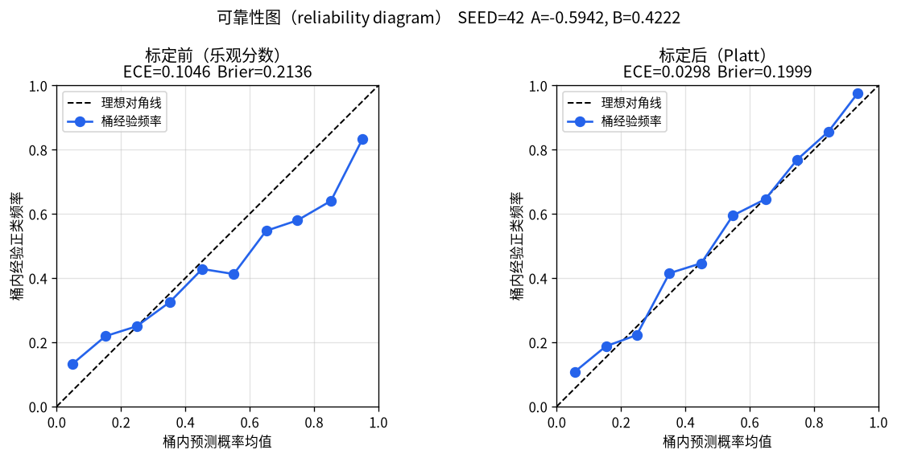

# Platt scaling：把分类分数收成可用概率

许多分类器给出的分数或伪概率，频率意义对不上；一旦下游要做阈值决策、期望收益，或按分数凯利（fractional Kelly）算注额，就需要接近真实频率的 \(P(y=1\mid x)\)。**Platt scaling（Platt 标定／sigmoid 概率标定）**就是在已有分数上后处理出校准概率的经典做法。本文不重讲泊松比分模型本身，只讲标定这一步。

配套演示脚本：[`2026-10-16-platt_scaling.py`](/notes-code/2026-10-16-platt_scaling.py)  


## 是什么

John C. Platt 在 1999 年收入 *Advances in Large Margin Classifiers* 的文章 *Probabilistic Outputs for Support Vector Machines and Comparisons to Regularized Likelihood Methods* 里提出：先照常训练支持向量机（Support Vector Machine，SVM），再在独立数据上拟合一个两参数 sigmoid，把未阈值输出 \(f\) 映射成后验概率。公式是：

\[
P(y=1\mid f)=\frac{1}{1+\exp(Af+B)}
\]

其中 \(A,B\) 用二项／伯努利最大似然（等价于交叉熵）估计。思路是：不改主模型训练，只加一道很轻的后处理，让输出能进效用模型、阈值规则或与别的概率源相乘相加。

scikit-learn 的 `CalibratedClassifierCV(method="sigmoid")` 与内部 `_SigmoidCalibration` 实现的就是这套 logistic 标定（文档写明基于 Platt 的模型）。同一模块的 `method="isotonic"` 则是非参数保序回归（pair-adjacent violators，PAV），对应 Zadrozny & Elkan 以及 Niculescu-Mizil & Caruana（ICML 2005）里对照的另一条路。

「校准好」的直观标准：在预测概率接近 \(0.8\) 的样本里，大约 \(80\%\) 真的是正类。可靠性图（reliability diagram）把预测概率分桶，横轴画桶内预测均值，纵轴画桶内经验正类频率；理想情况下点落在对角线上。

## 怎么工作

### 为什么需要标定

SVM 的决策函数、某些提升树的 margin、过拟合网络的 softmax，往往只保证排序还行，不保证频率。Niculescu-Mizil & Caruana（2005）在多个数据集上观察到：最大间隔类方法（SVM、提升树等）常把概率质量往 \(0.5\) 附近挤，可靠性图呈 sigmoid 形失配；朴素贝叶斯则常把概率往 \(0/1\) 两端推。神经网络、装袋树等有时本来就较准，再硬套标定反而可能伤一点尾巴。

若你拿「看起来像 \(0.85\)」的分数直接当 \(85\%\) 赢面去算凯利注额，乐观桶会系统性加注过度；产线故障概率同理——假阳性代价和漏检代价不对称时，阈值必须挂在真实频率上，不能挂在未校准分数上。

### 拟合 \(A,B\)

给定标定集上的分数 \(f_i\) 与标签 \(y_i\in\{0,1\}\)，令

\[
p_i=\frac{1}{1+\exp(Af_i+B)}
\]

最小化负对数似然 \(\sum_i\bigl[-t_i\log p_i-(1-t_i)\log(1-p_i)\bigr]\)。Platt 不用硬标签 \(0/1\) 当 \(t_i\)，而用平滑目标，减轻在边界上拟合出「永远 \(0\) 或 \(1\)」的过拟合：设标定集有 \(N_+\) 个正例、\(N_-\) 个负例，则

\[
t_+=\frac{N_++1}{N_++2},\qquad t_-=\frac{1}{N_-+2}
\]

正例目标为 \(t_+\)，负例为 \(t_-\)。这是贝叶斯意义上对二项比例的弱先验收缩，不是随便加的噪声。

优化上原论文用带动量的梯度法；后来 Lin, Lin & Weng（*Machine Learning* 2007）给出数值更稳的牛顿法伪代码。演示脚本用带解析梯度的 L-BFGS-B 最小化同一交叉熵，结果与「两参数 logistic」一致即可。

### 与 isotonic（PAV）差在哪

- **Platt／sigmoid**：只假设失配能用一条 logistic 曲线拧回来；参数两个，小样本更稳。
- **Isotonic／PAV**：只假设映射单调不减，形状任意阶梯；更灵活，但标定集小时易过拟合。

Niculescu-Mizil & Caruana（2005）的学习曲线：标定集大约小于 \(200\)–\(1000\) 时 Platt 往往更好；达到约 \(1000\) 及以上时，isotonic 通常不差于 Platt，复杂失配时更有优势。scikit-learn 用户指南据此写明：数据够多（大约大于 \(1000\) 样本）时 `'isotonic'` 表现会达到或不亚于 `'sigmoid'`。习惯上标定集 \(n<1000\) 先试 Platt，更大再比 isotonic，并看可靠性图是否呈 S 形。

### 泄漏门（必须写进流程）

标定必须用**训练主模型之外**的验证／时间切分数据。若拿训练集上几乎完美分开的 \(f\) 去拟合 sigmoid，会得到接近阶跃的映射，测试集上必碎。scikit-learn 的 `CalibratedClassifierCV` 用交叉验证保证拟合标定器时用到的是「对当前折未见」的预测。

落到足球 walk-forward：每个训练窗内应再切一块（或该窗内嵌套时序折）只做标定；测试窗只做推理，禁止用测试标签更新 \(A,B\)。主模型与标定器都在同一测试窗上「偷看」赛果，等于泄漏门一票否决——这和第 6 层验收说的泄漏精神一致。

## 复杂度和代价

- **拟合**：在标定集上迭代优化两个参数，相对主模型训练通常很轻；\(n\) 为标定样本量时，每次迭代扫一遍分数即可。
- **推理**：每个样本一次 \(Af+B\) 再 sigmoid，时间 \(O(1)\)，几乎可忽略。
- **局限**：
  1. 假设失配大致是 sigmoid 形；倒 S、多拐点或严重类别不平衡时，logistic 可能拧不直，应看图改 isotonic 或 beta calibration 等。
  2. 标定不能从零创造区分力：排序一塌糊涂时，概率会被收得「老实」，但决策仍可能没用。
  3. 分布漂移后 \(A,B\) 会过期，需按时间窗重估。
  4. 多类问题常见做法是一类对其余再归一化；深度网络多类更常谈温度缩放（temperature scaling）。

## 应用场景

1. **产线／设备故障概率进阈值**：孤立森林、提升树、SVM 给出异常分或伪概率后，用一段有标签的检修记录做 Platt，再设「停机检修」阈值。假阳性停线和漏检坏件的代价不对称时，阈值应基于校准概率，而不是原始分位数。
2. **足球模型概率进注额前标定**：第 2 层信号给出的模型概率或相对市场 edge，在进第 5 层分数凯利之前，用训练窗外的验证切片做 Platt（或样本够时的 isotonic）。平博／竞彩结算与 walk-forward 档位不变；标定只修正「模型说的 \(p\)」与历史频率的系统性偏差。
3. **任意「分数好看但不信频率」的二分类后处理**：邮件过滤、质检 OK／NG、广告点击率等，只要能拿到独立验证标签，都可以先画可靠性图，再决定是否上 sigmoid 标定。

## 实例：偏乐观分数的可靠性（主）＋产线／注额直觉（副）

脚本 `SEED=42`。构造真实风险 \(p\sim\mathrm{Beta}(2,2)\)，标签 \(y\sim\mathrm{Bernoulli}(p)\)。未校准分数刻意做成「更陡 + 正向偏置」：

\[
f=1.75\cdot\mathrm{logit}(p)+0.55,\qquad \hat{q}=\sigma(f)
\]

于是原始预测均值高于真实正类率（偏乐观），且中高概率桶上预测系统性高于经验频率。标定集 \(n=800\)（正例 \(386\)、负例 \(414\)），测试集 \(n=2000\)。平滑目标 \(t_+\approx 0.9974\)，\(t_-\approx 0.0024\)。拟合得：

\[
A\approx -0.5942,\qquad B\approx 0.4222
\]

测试集上：原始预测均值 \(\approx 0.580\)，标签率 \(\approx 0.4985\)；标定后预测均值 \(\approx 0.477\)。十个等宽桶的期望校准误差（Expected Calibration Error，ECE；各桶 \(|\text{预测均值}-\text{经验频率}|\) 按样本数加权）从约 \(0.105\) 降到约 \(0.030\)；Brier 分数从约 \(0.214\) 降到约 \(0.200\)。

手算核对：\(f=0\) 时 \(P=1/(1+\mathrm{e}^{B})\approx 0.396\)（因为 \(B>0\)，零分点被拉到低于 \(0.5\)，抵消乐观偏置）。Platt／sklearn 约定下分数越大应对应越高正类概率时，\(A\) 通常为负；这里 \(A\approx -0.59\) 符合该约定。高概率桶例子：标定前 \([0.8,0.9)\) 桶预测均值 \(\approx 0.853\)、经验频率仅 \(\approx 0.641\)（缺口约 \(0.21\)）；标定后同段附近缺口缩到约 \(0.01\) 量级。图见 `/notes-assets/n-20261016-205600/platt_scaling_reliability.png`。

**产线直觉**：若未校准模型常把「其实只有六成会在当班出故障」的工况报到 \(0.85\)，按 \(0.85\) 去触发昂贵停机就会偏频；Platt 把该分映射回接近 \(0.64\) 后，阈值才能和历史故障频率对齐。

**注额直觉**：分数凯利注额大致随「优势 \(\times\) 校准概率」伸缩。把 \(0.85\) 当成真概率会系统性加大仓位；先标定再乘水位／扣佣，才是第 5 层风控假定的输入。演示是人造乐观失配，真实亚盘切片要以 walk-forward 窗内嵌套标定为准，数字不会与本文 \(A,B\) 相同。

核心拟合（完整脚本含造数、分桶、ECE、作图）：

```python
def platt_targets(y):
    n_pos = (y == 1).sum()
    n_neg = (y == 0).sum()
    t_pos = (n_pos + 1.0) / (n_pos + 2.0)
    t_neg = 1.0 / (n_neg + 2.0)
    return np.where(y == 1, t_pos, t_neg)

def fit_platt(f, y):
    t = platt_targets(y)
    def nll(params):
        a, b = params
        # Platt 1999 / sklearn: P = 1/(1+exp(A f + B))
        p = 1.0 / (1.0 + np.exp(a * f + b))
        p = np.clip(p, 1e-12, 1 - 1e-12)
        return -np.sum(t * np.log(p) + (1 - t) * np.log(1 - p))
    # 用 L-BFGS-B + 梯度最小化 nll，得到 A, B
    ...
    return A, B

def apply_platt(f, A, B):
    return 1.0 / (1.0 + np.exp(A * f + B))
```

环境无 sklearn 时本演示纯 numpy／scipy；有 sklearn 可用 `CalibratedClassifierCV(..., method="sigmoid")` 对照，但主路径保持自实现便于读懂。

## 延伸思考

- **温度缩放（temperature scaling）**：对 logits 除以标量 \(T\) 再 softmax；多类深度网络常用，参数比逐类 Platt 更少（Guo et al., ICML 2017）。
- **Isotonic／PAV**：样本多、失配不是单纯 S 形时的非参数替代；注意可能引入概率并列、影响纯排序类指标。
- **期望校准误差 ECE** 与可靠性图细读：分桶宽度、样本量不足的桶方差；以及 Brier／log loss 同时混有校准与区分力，不能单靠一个标量下结论。
- **Beta calibration** 等比两参数 sigmoid 稍灵活的参数族，适合不平衡场景。

## 参考

- John C. Platt, Probabilistic Outputs for Support Vector Machines and Comparisons to Regularized Likelihood Methods, in *Advances in Large Margin Classifiers*, MIT Press, 1999（pp. 61–74）
- Alexandru Niculescu-Mizil & Rich Caruana, Predicting Good Probabilities With Supervised Learning, ICML 2005（[作者页 PDF](https://www.cs.cornell.edu/~alexn/papers/calibration.icml05.crc.rev3.pdf)）
- scikit-learn User Guide, [1.16. Probability calibration](https://scikit-learn.org/stable/modules/calibration.html)（sigmoid／isotonic／约 \(1000\) 样本启发式、`CalibratedClassifierCV`）
- Hsuan-Tien Lin, Chih-Jen Lin & Ruby C. Weng, A note on Platt’s probabilistic outputs for support vector machines, *Machine Learning* 68:267–276, 2007（更稳的拟合算法）
