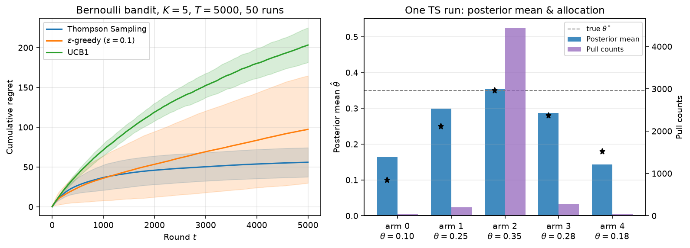

# 汤普森采样：用后验抽样做探索与利用的概率匹配

在线决策里常碰到的麻烦是：**同一时刻只能试一个选项，事后才知道赚没赚到。** 产线数字孪生里要在几种加热功率档位之间择优，网页上要在几个按钮文案之间做 A/B，广告系统要在多个创意之间分配曝光——都无法像离线监督学习那样先把所有样本凑齐再训模型。多臂老虎机（multi-armed bandit）把这类问题抽象成「\(K\) 个臂、每轮拉一根、拿一次随机回报」；**汤普森采样（Thompson Sampling）** 是其中一种用概率匹配做探索—利用权衡的经典策略：按「当前后验里谁最优」的概率去选臂，而不是人为拧一个探索系数。

配套演示脚本见交付包 `code/2026-10-19-thompson_sampling_bernoulli.py`  

## 是什么

设想 \(K\) 台老虎机（臂），第 \(i\) 台每次拉动以未知概率 \(\theta_i\in(0,1)\) 吐出「成功」（回报 \(1\)），否则吐出 \(0\)。决策者每轮只能拉一台；目标是让累计成功尽量多，或者说让相对最优臂的**累计遗憾（cumulative regret）**尽量小。遗憾在第 \(t\) 轮定义为 \(\theta^*-\theta_{a_t}\)，其中 \(\theta^*=\max_i\theta_i\)，\(a_t\) 是本轮选中的臂。

汤普森采样的核心直觉可以画成一张画面：**脑子里为每个臂维护一份「成功率可能是多少」的概率分布；每轮从这些分布里各抽一个假想成功率，然后只信这一轮抽到的那张「假想排行榜」，去拉榜首。** 不确定性大的臂，后验分布更宽，偶尔会抽到虚高的值，于是被探索；已经摸清且确实强的臂，后验尖而高，绝大多数轮次都会赢采样赛。这叫**概率匹配（probability matching）**：选臂 \(i\) 的频率，近似等于「在当前后验下 \(i\) 真是最优」的概率。

这个想法可以追溯到 William R. Thompson 1933 年发表于 *Biometrika* 第 25 卷第 3/4 期（第 285–294 页）的论文 *On the likelihood that one unknown probability exceeds another in view of the evidence of two samples*：在临床试验双臂背景下，讨论「未知治愈率谁更大」的后验概率，并据此决定下一名患者分到哪一臂。工业与推荐场景的大规模实证，则有 Olivier Chapelle 与 Lihong Li 在 NeurIPS 2011 的 *An Empirical Evaluation of Thompson Sampling*；系统教程见 Daniel J. Russo、Benjamin Van Roy、Abbas Kazerouni、Ian Osband、Zheng Wen 合著的 *A Tutorial on Thompson Sampling*（*Foundations and Trends in Machine Learning* 第 11 卷第 1 期，第 1–96 页，2018；预印本 arXiv:1707.02038）。

## 怎么工作

### Beta–Bernoulli 共轭

演示固定在最干净的设定：**Bernoulli 回报 + Beta 先验**。对臂 \(i\)，先验取

\[
\theta_i\sim\mathrm{Beta}(\alpha_i,\beta_i),
\]

其中 \(\alpha_i\) 可以直觉成「先验里已经看到的成功次数加一档」，\(\beta_i\) 对应失败。均匀先验 \(\mathrm{Beta}(1,1)\) 表示开局对所有臂同样无知。观测到一次成功后 \(\alpha_i\leftarrow\alpha_i+1\)，失败则 \(\beta_i\leftarrow\beta_i+1\)。因为 Beta 是 Bernoulli 似然的共轭先验，后验仍然是 Beta，更新只要做两次加法。后验均值是

\[
\mathbb{E}[\theta_i\mid\mathrm{data}]=\frac{\alpha_i}{\alpha_i+\beta_i},
\]

方差随 \(\alpha_i+\beta_i\)（等效样本量）增大而缩小——摸得越多，采样时越难「虚高翻盘」。

### 每轮算法

设当前各臂参数为 \((\alpha_i,\beta_i)_{i=1}^K\)。第 \(t\) 轮：

1. 对每个臂独立采样 \(\tilde\theta_i\sim\mathrm{Beta}(\alpha_i,\beta_i)\)。
2. 选择 \(a_t=\arg\max_i\tilde\theta_i\)（若并列可任选或随机破平）。
3. 拉动臂 \(a_t\)，观测 \(r_t\sim\mathrm{Bernoulli}(\theta_{a_t})\)。
4. 若 \(r_t=1\) 则 \(\alpha_{a_t}\leftarrow\alpha_{a_t}+1\)，否则 \(\beta_{a_t}\leftarrow\beta_{a_t}+1\)。

没有显式的 \(\varepsilon\)，也没有手写的置信上界公式：探索完全由后验宽度驱动。

### 与 ε-greedy、UCB1 的对照

| 策略 | 探索机制 | 常见调参 |
|---|---|---|
| \(\varepsilon\)-greedy | 以固定（或衰减）概率 \(\varepsilon\) 均匀乱选 | \(\varepsilon\) 太大则永远浪费曝光；太小则早期锁死次优 |
| UCB1 | 选「经验均值 + \(\sqrt{2\ln t/n_i}\)」最大的臂 | 上界偏保守时，次优臂会被长时间重复试探 |
| 汤普森采样 | 按后验「谁最优」的概率选臂 | Beta–Bernoulli 下几乎无旋钮；换模型族时要设计先验与采样器 |

三者都在「利用当前最好」和「弄清还不确定的」之间找平衡；汤普森采样把平衡交给贝叶斯后验，而不是交给一个全局 \(\varepsilon\) 或一条固定宽度的置信带。

## 复杂度和代价

- **每轮时间**：\(K\) 次独立 Beta 采样 + 一次 \(\arg\max\)，合计 \(O(K)\)。标准库（如 NumPy 的 `Generator.beta`）对中等 \(K\) 足够；\(K\) 到上万时往往改用批采样或分层／级联结构，那是工程扩展，不是算法本身变了。
- **内存**：每臂两个浮点参数 \((\alpha,\beta)\)，\(O(K)\)。
- **统计代价**：有限时域上的累计遗憾随问题难度（臂间距、先验）变化；教程文献在多种模型下给出贝叶斯遗憾与频繁派遗憾的理论脉络，Bernoulli 实验里经验上常看到汤普森采样的遗憾曲线低于固定 \(\varepsilon\) 的贪心，也常低于偏保守的 UCB1——下文用可复现数字核对。
- **工程代价**主要在「一次试验的反馈是否干净、延迟多大、上下文是否要进模型」。无上下文的 Beta–Bernoulli 实现极轻；有访客或页面等上下文特征时要换成 logistic／线性高斯等后验近似（Laplace、变分、 perturbation），采样成本会上去。

## 应用场景

- **产线／数字孪生参数择优**：几种工艺档位（温度、转速、进给）只能在线试，每次试产有合格／不合格或良率抽样；用汤普森采样把流量逐渐集中到后验最优档。
- **网页 A/B 与产品实验**：按钮文案、落地页布局、推荐策略变体；比传统「均分流量跑满再决策」更能在实验中途就把更多流量导向当前更可能更好的变体。
- **广告创意与推荐试探**：多个素材或召回策略争曝光；成功定义为点击或转化。
- **临床试验与自适应分配**：Thompson 原文的动机场景；现代试验设计里仍有人用概率匹配做响应自适应随机化（须满足伦理与监管约束）。
- **游戏与对话系统**：技能、关卡难度、回复策略的在线试探。

## 实例一：Bernoulli 多臂对照实验（可复现）

场景参数写死在演示脚本里（`SEED=42`）：

- 臂数 \(K=5\)，真实成功率 \(\theta=[0.10,\,0.25,\,0.35,\,0.28,\,0.18]\)，最优臂是第 3 臂（下标 \(2\)），\(\theta^*=0.35\)。
- 先验：每臂 \(\mathrm{Beta}(1,1)\)。
- 地平线 \(T=5000\) 轮；独立重复 \(n_{\mathrm{runs}}=50\) 次，报告终端累计遗憾的均值与样本标准差。
- 对照：\(\varepsilon\)-greedy（\(\varepsilon=0.1\)）、UCB1（每臂先各拉一次，其后用 \(\sqrt{2\ln t/n_i}\) 奖励项）。

| 策略 | 平均累计遗憾（\(T=5000\)） | 标准差（50 次） |
|---|---|---|
| 汤普森采样 | \(55.99\) | \(18.34\) |
| \(\varepsilon\)-greedy（\(\varepsilon=0.1\)） | \(97.30\) | \(67.37\) |
| UCB1 | \(203.24\) | \(21.81\) |

同一随机种子派生出的一次汤普森采样轨迹里，五臂被拉动的次数约为 \([47,\,202,\,4434,\,277,\,40]\)：最优臂吃掉了绝大多数试验，邻近的次优臂（\(0.28\) 与 \(0.25\)）仍保有几百次以确认差距，最差的两臂很快被后验压下去。该次运行结束时的后验均值约为 \([0.163,\,0.299,\,0.354,\,0.287,\,0.143]\)，已经贴近真 \(\theta\)，最优臂后验均值 \(0.354\) 与真值 \(0.35\) 只差大约四个千分点。演示图左侧是三条策略的平均累计遗憾曲线（阴影为 \(\pm 1\) 标准差）；右侧是该次运行的后验均值与分配次数。

读表时注意两点。第一，\(\varepsilon=0.1\) 意味着即使已经认清最优臂，仍有约一成流量在随机浪费，所以平均遗憾高于汤普森采样，且方差很大（有的重复早期锁错臂）。第二，UCB1 的 \(\sqrt{2\ln t/n_i}\) 在本参数下偏「爱探索」：次优臂会被反复拉到很晚，累计遗憾大约是汤普森采样的三到四倍。换更紧的置信项或 asymptotics 改进版 UCB，名次可能变化；这里对照的是教科书默认形式，用来钉死「概率匹配 vs 固定乱选 vs 固定上界」三种机制，而不是宣布某算法永远第一。

## 实例二：装配工位加热档位的在线择优

假设某贴片回流工位有五个离散加热档位，数字孪生每班只能按一个档位跑一小批板，并以抽检合格率作为 Bernoulli 式反馈（合格 \(=1\)）。真合格率未知，但与上面演示同一数量级：有一档明显更好，另有两档接近。若采用固定 \(\varepsilon\) 乱切流量，产线会持续把一成批次送给已知较差的档；若采用汤普森采样，孪生侧维护五个 \((\alpha,\beta)\)，每批开始前做一次后验抽样选档，批末用合格／不合格更新。运行数千批之后，流量会像演示右侧条形图那样集中到最优档，同时保留对「第二名」的少量试探，以防工况漂移后排名翻转。

把同一套逻辑搬到网页 A/B：五个落地页标题，成功定义为「点击注册」。传统均分要把实验跑满才切主版本；汤普森采样从第一天起就按后验最优概率分配流量，实验中后期主版本自然获得更多曝光，累计转化损失（遗憾）通常更小。若还要按设备类型、来源渠道拆分，就把「臂」扩成上下文老虎机（contextual bandit），后验从标量 Beta 换成带特征的回归模型——机制仍是「采样一个假想世界，再在那个世界里贪心」。

## 局限和要注意的地方

1. **模型要对上生成过程**。Bernoulli + Beta 适合 0/1 即时反馈；若回报是延迟转化、连续金额或重尾，需要换似然与先验，否则后验会系统性偏。
2. **延迟与批次**。反馈隔很多轮才回来时，不能假装每轮都更新；实务上会用「已发出未回执」的乐观或保守修正，或改成批次汤普森采样。
3. **非平稳**。产线换季、网页改版后 \(\theta\) 会漂。可用折扣、滑窗重置 \((\alpha,\beta)\)，或显式做变点检测后再抬高探索。
4. **安全与约束**。医疗、高价值产线往往不允许纯后验采样把流量砸向高风险臂；需要加安全集、约束老虎机或人工审批门槛。
5. **评估指标**。在线看累计遗憾或机会成本；离线回放要注意日志偏差（当时策略没探到的臂，反事实估计要额外方法）。

## 延伸思考

1. 把演示里的 \(\theta\) 间距改小（例如最优 \(0.35\)、次优 \(0.34\)），观察汤普森采样与 UCB1 的遗憾曲线谁先弯折——臂越难分清，越需要更长的探索。
2. 将先验从 \(\mathrm{Beta}(1,1)\) 改成 \(\mathrm{Beta}(5,5)\)（更强地相信「大家差不多在 \(0.5\)」），看早期是否更不敢拉开差距。
3. 若每轮能同时观察上下文特征（班次、原材料批次），试把臂奖励改成 logistic 线性模型，用 Laplace 近似做一次汤普森采样，对比无上下文版本的累计合格率。

## 参考文献

1. [W. R. Thompson, “On the likelihood that one unknown probability exceeds another in view of the evidence of two samples,” *Biometrika* 25(3/4):285–294, 1933.](https://doi.org/10.1093/biomet/25.3-4.285)
2. [D. J. Russo, B. Van Roy, A. Kazerouni, I. Osband, Z. Wen, “A Tutorial on Thompson Sampling,” *Foundations and Trends in Machine Learning* 11(1):1–96, 2018; arXiv:1707.02038.](https://arxiv.org/abs/1707.02038)
3. [O. Chapelle, L. Li, “An Empirical Evaluation of Thompson Sampling,” NeurIPS 2011.](https://proceedings.neurips.cc/paper/2011/file/e53a0a2978c28872a4505bdb51db06dc-Paper.pdf)
