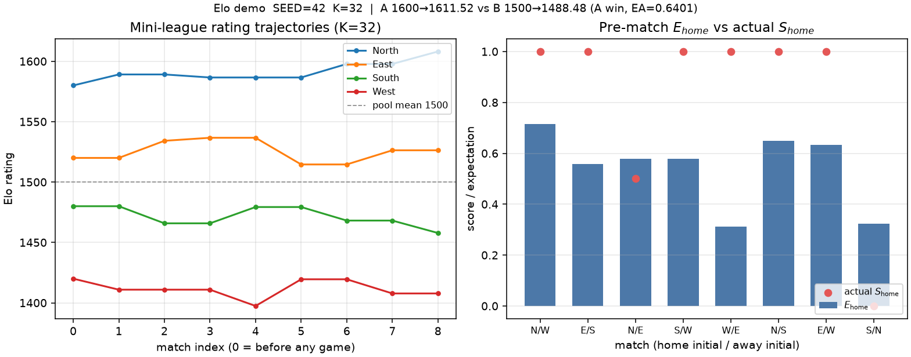

# Elo 评分：一场赛果如何把强弱差改写成下一次的期望胜率

两队开赛前评分差 100 分（1600 对 1500）时，经典 Elo 公式给出较强一方的期望得分约 **0.640**；若较强方赢下比赛、发展系数 \(K=32\)，较强方大约只涨 **+11.52** 分，较弱方对称跌同样幅度。读完本文可以按 SEED=42 复现脚本，弄清期望得分 \(E\)、实际得分 \(S\) 与更新式 \(R'=R+K(S-E)\) 的对应关系，以及同一套逻辑怎样挪到足球强弱预测与产线工位健康分。

配套演示脚本见交付包 `code/2026-10-25-elo_rating.py`


## 是什么

**Elo 评分（Elo rating）** 用一个标量描述对局里各方的相对强弱，再用评分差预测下一场的期望得分；赛后按「实际得分相对期望偏了多少」线性修正评分。系统由匈牙利裔美国物理学家、国际象棋大师 **Arpad Elo** 在 1960 年代为美国棋协（USCF）设计，用以替换主观色彩更重的 Harkness 体系；他在 1978 年的 *The Rating of Chessplayers, Past and Present* 里给出了完整说明。世界棋联（FIDE）自 1970 年起采用同类框架，现行规章里仍用评分差查期望得分、再乘发展系数 \(K\) 做周期更新。

现代实现里，期望得分常用 **对数逻辑曲线（logistic）**，尺度常数取 400：每强 400 分，期望得分之比约为 10∶1。这与 Bradley–Terry 成对比较模型同族。足球、网球、电竞、部分程序竞赛排行，以及 FIFA 男女足世界排名的若干版本，都借用了同一骨架；FiveThirtyEight 等媒体在 NFL 等项目上公开过带主场、休息日、分差乘数的 Elo 变体。俱乐部足球侧他们后来转向 SPI（带进攻／防守分与期望进球），但「用相对强弱生成赛前概率、赛后按意外程度改分」的思路一脉相承。

评分只在**同一池子**内可比，不是绝对能力的物理单位。两套联盟、两套 \(K\)、两套入池规则算出来的数字不能直接横比。

## 怎么工作

### 直觉画面

把每一方想成一把「目前公认的强弱尺子」。尺子差得越大，强的一方赛前就该带走越多「得分份额」：赢记 1、平记 0.5、负记 0。若强队赢了弱队，只是兑现了大部分预期，尺子几乎不动；若弱队爆冷赢了，说明尺子标矮了弱队、标高了强队，两边要大幅对调。平局时，较强方会略降、较弱方略升，因为较强方「该赢更多」。

\(K\) 管的是**一次意外能拧动尺子多大**：\(K\) 大，近期赛果权重大、分跳得猛；\(K\) 小，历史惯性强、分动得慢。FIDE 按新人／未满 2400／已达 2400 等阶段把 \(K\) 设成 40、20、10；USCF 周末短赛传统上常用较大的固定 \(K\)（例如 32）。本文演示把 \(K\) **写死为 32**，方便手算与脚本逐位相符。

### 形式定义（挂回直觉）

记甲方评分 \(R_A\)、乙方 \(R_B\)。甲方期望得分

\[
E_A=\frac{1}{1+10^{(R_B-R_A)/400}},\qquad E_B=1-E_A.
\]

\((R_B-R_A)/400\) 是把「分差」换成对数几率上的距离：乙方每高 400 分，甲方期望得分大约变成原来的十分之一量级。\(E_A\) 本身是**得分期望**（胜概率加一半平局概率），不是单纯的「必胜概率」；Elo 经典写法不单独拆出平局概率，而是把平局折成半胜。

赛后甲方实际得分 \(S_A\in\{0,0.5,1\}\)，更新

\[
R_A'=R_A+K\,(S_A-E_A).
\]

白话：实际比期望多拿的每一分，按 \(K\) 倍加到评分上；少拿则扣分。乙方对称更新。双方变动幅度在经典零和设定下大小相等、符号相反（同一场、同一 \(K\)）。

### 可核对的小例子（演示设定）

脚本参数写死：`SEED=42`，`K=32`，尺度 400。聚光灯对局：

- \(R_A=1600\)，\(R_B=1500\)
- \(E_A=1/(1+10^{(1500-1600)/400})=1/(1+10^{-0.25})\approx\mathbf{0.640065}\)
- \(E_B\approx\mathbf{0.359935}\)

甲方获胜（\(S_A=1,S_B=0\)）：

\[
\begin{aligned}
R_A'&=1600+32\times(1-0.640065)\approx\mathbf{1611.518},\\
R_B'&=1500+32\times(0-0.359935)\approx\mathbf{1488.482}.
\end{aligned}
\]

若改判平局（\(S=0.5\)），则 \(R_A'\approx 1595.518\)（约 −4.48）、\(R_B'\approx 1504.482\)（约 +4.48）：强队「只打平」会被扣分。

同脚本里还有一个四队小联赛（North／East／South／West 初值 1580／1520／1480／1420），按固定赛程滚八场。赛前 \(E_{\mathrm{home}}\) 与实际 \(S_{\mathrm{home}}\) 对照见演示图右幅；左幅是评分轨迹。例如第 5 场 West 主场对 East 时期望仅约 0.310，却主队取胜，West 从约 1397 跳到约 1420，East 对称回落——爆冷对分值的拉扯比「强队正常赢弱队」大得多。终局约为 North 1608.10、East 1526.31、South 1457.82、West 1407.76。

## 复杂度和代价

- **单场更新**：常数时间（几次幂与加减）；整季 \(m\) 场对 \(n\) 支队是 \(O(m)\)。
- **存储**：每队一个浮点评分；若做 Glicko／TrueSkill 一类扩展，还要存评分方差或协方差。
- **实现陷阱**：期望公式里是 \(10^{(R_{\mathrm{opp}}-R_{\mathrm{self}})/400}\)，符号反了会把强弱期望对调；平局必须用 \(S=0.5\)，不能当成「不更新」。
- **池子效应**：只玩弱队、回避强队、或新人入池规则不当，会导致通胀／通缩；FIDE 用评分下限、分段 \(K\)、报告周期等机制缓解，演示脚本没有这些护栏。
- **预测粒度**：经典 Elo 输出的是得分期望，不是完整的「胜／平／负」三元概率。足球若要拆平局，需要 Davidson 扩展、独立泊松进球模型，或像 SPI 那样先估进球再合成赛果分布。

## 应用场景

- **棋类与电竞**：FIDE／USCF 官方榜、在线对战平台的匹配与段位（不少站点已改用 Glicko-2，但仍以 Elo 为对照基线）。
- **足球与其它对抗项目**：国家队或俱乐部「谁更强、下一场期望几成」的滚动尺子；可加主场分、分差乘数（FiveThirtyEight 的 NFL Elo 公开方法里有这类项）。
- **程序竞赛与配对比较**：Codeforces 等平台的 rating 更新与 Elo／logistic 梯度下降同构。
- **产线／数字孪生**：把「工位本班达标 vs 对照基准」或「设备本班无故障停机 vs 参照机」映射成 \(S\in\{0,1\}\)，用同一更新式维护健康分或可靠度序，供调度与巡检排序（见实例二；边界须说清）。

## 实例一：足球小联赛的期望与赛后分

脚本 `code/2026-10-25-elo_rating.py` 先打印 1600 对 1500 的单场更新，再跑四队八场。左图横轴为「已完成场次序号」（0 为开赛前），纵轴为 Elo；右图每个柱是该场主队赛前期望 \(E_{\mathrm{home}}\)，红点是实际 \(S_{\mathrm{home}}\)。

读数要点：分差 100 时强队期望约 64.0% 的得分份额；兑现胜利后分值只挪约 11.5（\(K=32\)）。小联赛里 North 从 1580 抬到约 1608，West 在爆冷赢 East 时明显上跳后又被东边赢回去——轨迹形状直接反映「结果相对期望的残差」，而不是单纯的胜场计数。

把同一期望公式接到赛前盘口或自研概率模型时，常见用法是：用当前 Elo 差生成 \(E\)，再与机构隐含概率对照做校准；本文只演示评分更新本身，不涉及注额。

## 实例二：工位健康分（类比与边界）

把「本班是否达标」当成一场对「参照工位」的比赛：参照评分固定 \(R_{\mathrm{ref}}=1500\)，工位初值同为 1500，\(K=32\)。达标 \(S=1\)，未达标 \(S=0\)（此处无「平局」）。脚本里十个班次序列为

`[1,1,0,1,1,0,1,1,1,0]`

终值约 **1549.18**。前两班连续达标时，因 \(E\) 从 0.5 缓升，每班加分从 +16.00 降到约 +15.26；中途一次失败会扣约 17～19 分（因为当时已高于参照，失败更「意外」）。

**类比边界**：真实产线达标率受配方、班组、上游来料影响，不是封闭零和池；参照分固定等于假设「对照机永不漂移」。故障恢复若要区分「轻微报警」与「停线」，需要把 \(S\) 或 \(K\) 设计成有序多档，或改用带不确定性的 Glicko。健康分适合做**相对排序与趋势**，不宜直接当成物理可靠度百分比。

## 短代码（单场更新）

```python
def expected_score(r_self, r_opp, scale=400.0):
    return 1.0 / (1.0 + 10.0 ** ((r_opp - r_self) / scale))

def elo_update(r_self, r_opp, s, k=32.0):
    # s: 1 win, 0.5 draw, 0 loss
    e = expected_score(r_self, r_opp)
    return r_self + k * (s - e), e

# 1600 vs 1500, A wins → R'≈1611.517920, E≈0.640065
ra, ea = elo_update(1600.0, 1500.0, 1.0)
```

完整小联赛滚动、工位序列与出图见 `code/2026-10-25-elo_rating.py`。

## 局限和要注意的地方

1. **相对尺度。** 换池子、换 \(K\)、换入池分，数字含义就变；跨库硬比没有统计依据。
2. **平局与进球信息。** 经典 Elo 把平局折成 0.5，忽略分差与进球内容；足球若要用净胜球，需显式乘数或改用进球模型。
3. **非平稳能力。** 转会窗、伤病、战术更换会让「慢变均值」假设失效；可用更大 \(K\)、赛季衰减，或 Glicko／TrueSkill 一类带方差的模型。
4. **与概率校准的缝。** \(E\) 是模型内期望，未必等于长期频率；上生产预测前应用独立样本做可靠性图或 Brier 分解。

## 延伸思考

1. 固定分差 100，扫 \(K\in\{10,20,32,40\}\)，比较「强队赢弱队」与「弱队爆冷」两种情形下单场 \(\Delta R\) 的比。
2. 把期望改成 FIDE 查表（对分差截断到 400）后再更新，看与连续公式在大分差对局上差多少。
3. 为平局引入 Davidson 参数，使胜／平／负三元概率可分离，再对比经典 \(S=0.5\) 更新在高平局联赛里的偏差。
4. 在数字孪生里把工位 Elo 与滑动达标率、EWMA 残差报警并列，观察哪一种更早抓住「连续临界班次」。

## 参考文献

1. Arpad E. Elo, *The Rating of Chessplayers, Past and Present*, 2nd ed., Arco Publishing, 1986（1978 初版；期望得分与 \(R_n=R_o+K(W-W_e)\) 更新式）.
2. FIDE, *FIDE Rating Regulations*（现行文本；评分差与得分概率表、发展系数 \(K=40/20/10\) 等）.
3. Mark E. Glickman, “A Comprehensive Guide to Chess Ratings,” 以及后续 Glicko／Glicko-2 文献（对 Elo 简化假设与方差扩展的系统讨论）.
4. FiveThirtyEight, “How Our NFL Predictions Work”（公开 Elo 变体：主场、休息、分差乘数等工程项；俱乐部足球侧另见其 SPI 方法说明，作对照而非本文实现）.
