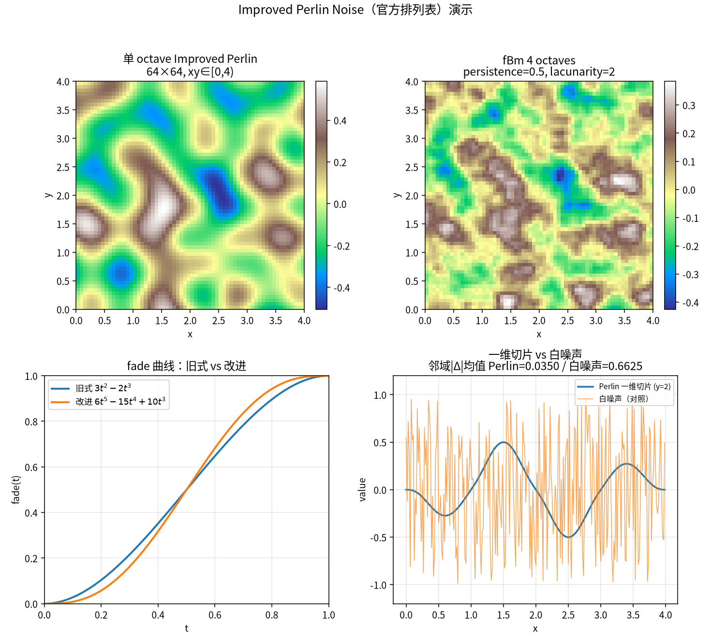

# 改进版 Perlin 噪声：把格子角点的梯度织成可复现的平滑程序化场

在 Ken Perlin 官方排列表下，Improved Perlin 噪声在点 \((0.5,\,0.5,\,0.0)\) 的取值恰好是 **−0.250000**；把同一套实现铺成 \(64\times 64\)、坐标范围 \(x,y\in[0,4)\) 的二维高度图，均值约 **0.000557**，值域约落在 \([-0.505,\,0.586]\)，相邻像素差分绝对值均值约 **0.0350**，而同尺寸均匀白噪声约为 **0.662**——平滑程度大约差 **19** 倍。读完本文可以按官方固定排列复现脚本，核对手算点与高度图统计，弄清 fade 曲线、十二方向梯度与三线性插值如何把离散格子织成连续、可复现的程序化场，并看到 4 层 octave 的 fBm 如何做出更像地形／磨损面的细节。

配套演示脚本见交付包 `code/2026-10-27-perlin_noise.py`


## 是什么

**改进版 Perlin 噪声（Improved Perlin Noise）** 是 Ken Perlin 在 SIGGRAPH 2002 论文 *Improving Noise*（ACM TOG 21(3):681–682，DOI 10.1145/566654.566636）里给出的经典程序化噪声。它在任意连续坐标 \((x,y,z)\) 上返回一个大致落在 \([-1,1]\) 附近的标量，相邻点变化平滑，且同一坐标永远得到同一结果——适合做地形高程、云层、磨损纹理、材质扰动等「看起来随机、实际上可复现」的场。

1985 年的原始 Perlin 噪声已经把「格子角点梯度 ＋ 插值」的骨架立住；2002 的改进主要换了两条：fade 从 \(3t^2-2t^3\) 换成端点一二阶导都为零的 \(6t^5-15t^4+10t^3\)，梯度方向收成立方体中心指向十二条棱中点的单位方向（再 pad 到 16 个哈希槽）。官方 Java 参考实现见 NYU 页面 `https://mrl.cs.nyu.edu/~perlin/noise/`，文中数字一律用该固定 **permutation** 表，不用 `numpy` 随机种子。

多层叠加（fBm／octaves）是应用层在噪声之上再做的频率合成；Simplex 噪声是另一族算法。本文主讲 Improved Perlin 本体。

## 怎么工作

### 直觉画面

把三维空间划成边长为 1 的单位立方体。每个整数格子角点事先挂一个伪随机梯度向量；查询点落到某个立方体内部后，先分别量出它到八个角点的位移，再与对应梯度做点积，得到八个「角点贡献」。最后用一条在端点处足够「平」的 fade 曲线，把相对坐标弯成插值权重，沿 \(x\)、\(y\)、\(z\) 做三次线性插值（三线性），把八个贡献揉成一个标量。

伪随机不是每次现场抽签，而是查一张写死的 0–255 排列 \(P\)：用整数坐标的低 8 位去哈希八个角，保证同一角点永远对应同一梯度编号。于是整张场是确定性的——换机器、换语言，只要排列与公式一致，同一点读数不变。

### 形式定义（挂回直觉）

记查询点 \((x,y,z)\)。令

\[
X=\lfloor x\rfloor\bmod 256,\quad
Y=\lfloor y\rfloor\bmod 256,\quad
Z=\lfloor z\rfloor\bmod 256,
\]

相对坐标 \(x'=x-\lfloor x\rfloor\)（\(y'\)、\(z'\) 同理）。改进版 fade 为

\[
\mathrm{fade}(t)=6t^5-15t^4+10t^3,
\]

满足 \(\mathrm{fade}(0)=0\)、\(\mathrm{fade}(1)=1\)，且一阶、二阶导在端点为零，格子交界处比旧式 \(3t^2-2t^3\) 更不易出现可见折痕。梯度函数把哈希低 4 位映射到 12 个方向（形如 \((\pm 1,\pm 1,0)\) 及其轴置换）。八个角的贡献经

\[
\mathrm{lerp}(t,a,b)=a+t(b-a)
\]

先沿 \(x'\)、再沿 \(y'\)、最后沿 \(z'\) 混合，即得 \(\mathrm{noise}(x,y,z)\)。

### 可核对的小例子

脚本用官方排列表打印：

| 查询点 | Improved fade | 旧式 fade \(3t^2-2t^3\) |
| --- | ---: | ---: |
| \((0.5,\,0.5,\,0.0)\) | **−0.2500000000** | −0.2500000000（中点两曲线同值） |
| \((0.25,\,0.25,\,0.0)\) | **0.0688476562** | −0.0234375000 |
| \((0,\,0,\,0)\)、\((1,\,0,\,0)\)、\((0,\,1,\,0)\) | **0** | 0 |

中点 \(\mathrm{fade}(0.5)=0.5\) 对两条曲线相同，所以噪声值重合，可当作实现正确性的第一道门。偏开中点后差异立刻出现：\(t=0.25\) 时旧式 fade≈0.15625、改进≈0.10352，\((0.25,0.25,0)\) 处噪声相差约 **0.0923**。整数格点上相对坐标为 0，插值塌成角点贡献的边界情形，官方实现给出 **0**，便于手算抽检。

## 复杂度和代价

- **单点查询**：常数次哈希、点积与 lerp，与坐标幅值无关（坐标先对 256 取模进表）；三维一次约几十次浮点运算。
- **栅格采样**：对 \(N\times N\) 高度图是 \(O(N^2)\)；再叠 \(k\) 个 octave 的 fBm 约为 \(O(kN^2)\)。演示里 \(64\times 64\)、单 octave 与 4 octave 都可在普通笔记本上瞬时跑完。
- **内存**：一张 512 长的排列副本（256 再复制一遍）即可；梯度不必存向量表，由哈希位现场解码。
- **实现陷阱**：fade 写错成旧式或漏掉五次多项式，会在格子缝出现导数不连续；排列表若被随机打乱，就无法与官方参考及他人结果对表；二维切片应固定 \(z=0\)（或常数），不要每次改 \(z\) 却以为在比二维。

## 应用场景

- **数字孪生／景观地形**：把噪声当高程或地表属性场，驱动网格顶点或贴图。
- **产线地面磨损／摩擦系数**：用平滑噪声场模拟「通道反复碾压更滑、边角更涩」的空间变化，给 AGV 动力学或能耗模型一个可复现的空间先验。
- **Unity Terrain／Three.js**：高度图数组可直接写入 TerrainData，或赋给 `PlaneGeometry` 顶点的 \(y\)；法线可由相邻高度差分估计。
- **前端程序化纹理**：云、木纹、迷雾、UI 背景扰动——GPU 上亦可移植同一公式做 fragment 噪声。

## 实例一：64×64 高度图与白噪声对照

在官方排列表下，对 \(x,y\in[0,4)\) 均匀取 \(64\times 64\) 点、\(z=0\)，得到单 octave 高度图：

- 均值 ≈ **0.000557**（接近 0）
- 最小 ≈ **−0.505**，最大 ≈ **0.586**（落在约 \([-1,1]\) 量级）
- 相邻像素（横／纵）差分绝对值均值 ≈ **0.0350**

同尺寸、`numpy` SEED=42 的均匀白噪声 \(U(-1,1)\) 相邻差分均值 ≈ **0.662**，约为 Perlin 的 **18.95** 倍。演示图左上是该高度图的 terrain 伪彩，右下用 \(y=2\) 的一维切片把「平滑起伏」和「白噪声毛刺」画在同一坐标轴上。

把同一范围叠 **4** 个 octave（persistence=0.5、lacunarity=2）做 fBm，均值仍接近 0，细节更密，更像自然地形的多尺度起伏；演示图右上即该面板。

## 实例二：车间地面摩擦系数场

把二维 Perlin／fBm 读成「相对磨损强度」，再线性映射到摩擦系数

\[
\mu(x,y)=0.60+0.25\cdot\mathrm{fBm}_4(x,y),
\]

在 \(x,y\in[0,8)\) 的 \(96\times 96\) 栅格上，脚本得到 \(\mu\) 均值约 **0.600**、范围约 **[0.488,\,0.729]**。数字孪生里可把这张场挂到地面碰撞或能耗模型：通道中央 \(\mu\) 略低（更「打滑」），边角略高。换种子只需换排列或给坐标加固定偏移；同一排列下，任意时刻重算同一格点都得到同一 \(\mu\)。

Unity 侧可将同一高度／属性图写入 Terrain；Web 前端可用 Three.js 的 `PlaneGeometry` 按行优先把数组写进顶点 \(y\)，再 `computeVertexNormals()`。二者吃的都是「可复现的标量栅格」，与噪声公式本身解耦。

## 短代码（调用核对）

```python
# 排列 P、fade、grad、noise 与官方 Java 参考一致；完整表见脚本
def fade(t):
    return t * t * t * (t * (t * 6 - 15) + 10)

print(f"{noise(0.5, 0.5, 0.0):.10f}")   # -0.2500000000
print(f"{noise(0.25, 0.25, 0.0):.10f}") # 0.0688476562
print(f"{noise(0.0, 0.0, 0.0):.10f}")   # 0.0000000000
```

完整官方排列表、旧式 fade 对照、\(64\times 64\) 统计、4 octave fBm、车间 \(\mu\) 映射与出图见 `code/2026-10-27-perlin_noise.py`。

## 局限和要注意的地方

1. **值域不是严格 \([-1,1]\)。** 理论与实现上常见略越界或略收窄；需要严格钳制时应在采样后 `clip`，或按应用重标定。
2. **各向异性与对角线。** 方格哈希在对角方向的频谱与轴对齐方向不完全相同；对视觉极敏感的材质有人改用 Simplex 或其他各向更匀的噪声。
3. **fBm 是叠加不是替换。** octave 数、persistence、lacunarity 决定「多粗糙」；它们不改变单层 Improved Perlin 的定义。
4. **排列表是契约。** 与官方或项目内其他模块对表时，必须使用同一排列；自行 `shuffle` 会破坏跨实现复现。

## 延伸思考

1. 把 fade 固定为改进式，仅打乱排列中 10% 的项，观察 \((0.5,0.5,0)\) 与高度图均值如何偏离本文数字。
2. 在同一 \(64\times 64\) 栅格上扫描 octave＝1…6，画出相邻差分均值随 octave 的变化曲线。
3. 将高度图导出为 RAW／PNG，分别喂给 Unity Terrain 与 Three.js 平面，核对顶点极值是否与脚本 min／max 一致。
4. 对照阅读 Simplex 噪声的梯度与单纯形剖分，列出它在对角方向上相对 Improved Perlin 的直观差异（不必改本文主实现）。

## 参考文献

1. [Ken Perlin, “Improving Noise,” *ACM Transactions on Graphics* (SIGGRAPH 2002), 21(3):681–682.](https://doi.org/10.1145/566654.566636)（作者 PDF：[NYU](https://mrl.cs.nyu.edu/~perlin/paper445.pdf)）
2. [Ken Perlin, Improved Noise Java reference implementation](https://mrl.cs.nyu.edu/~perlin/noise/)
3. [Ken Perlin, “An Image Synthesizer,” *Computer Graphics* (SIGGRAPH 1985)](https://doi.org/10.1145/325165.325247)——原始 Perlin 噪声（公开拷贝 PDF：[rmarcus.info](https://rmarcus.info/blog/assets/perlin/perlin_paper.pdf)）.
4. [Perlin noise — Wikipedia](https://en.wikipedia.org/wiki/Perlin_noise)（改进版 fade、梯度与 fBm／octave 叠加的程序化噪声综述）.
