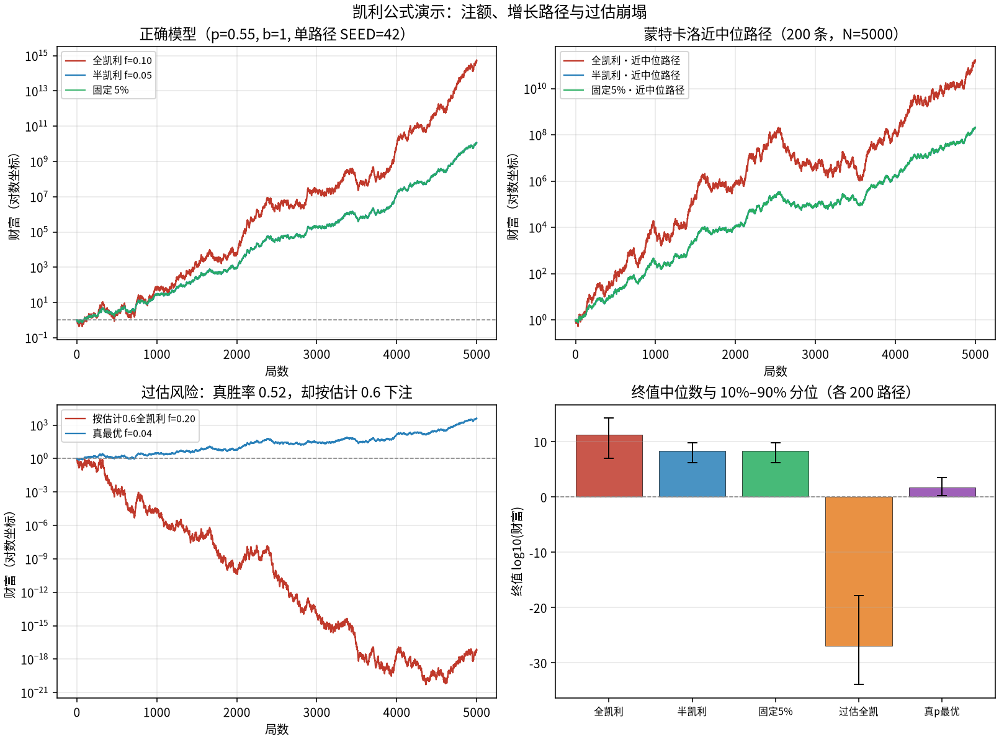

# 凯利公式

同样是「略有优势」的多次投注，本金每次押 **10%** 还是 **5%**，五千局之后财富量级可以差出几个数量级。设胜率 **p=0.55**、净赔率 **b=1**（赢一块赚一块），凯利公式给出的全凯利注额比例是 **f\*=0.10**，半凯利是 **0.05**；在 **SEED=42** 的同一串胜负下，五千局后全凯利路径终值约 **5.13×10¹⁴**，半凯利约 **1.15×10¹⁰**。读完可以按脚本复现这组数字，弄清 f\* 怎么从优势与赔率推出来，以及为什么把胜率估高一点，财富曲线会掉头崩塌。

配套演示脚本见交付包 `code/2026-11-02-kelly.py`


## 是什么

**凯利公式（Kelly Criterion）** 回答一个很窄的问题：若你对某次二元结果有自己的胜率估计 p，市场上的净赔率是 b:1（输掉则输掉全部押注本金，赢则净赚 b 倍押注），一次该拿现有本金的多大比例 f 去押，才能让长期财富的**几何增长率**最大。

1956 年 J. L. Kelly Jr. 在贝尔实验室从信息率角度给出解释：最大化 \(\mathbb{E}[\log W]\)，等价于在重复独立博弈中追求财富的渐近增长率，而不是单次期望盈利最大。后者会怂恿你在有正期望时押上全部本金——一次失手就归零；凯利则按「优势有多大、赔率给多少」把注额压成比例。

本文只处理最经典的**二进制赔付**：赢或输、输光当次注码、没有推盘与部分赎回。实务里足球亚盘、串关、相关市场都更复杂，但同一条「edge / 赔率 → 比例」的骨架仍然好用。

## 怎么工作

### 直觉画面

把现有本金看成一块蛋糕。每押一次，你切走比例 f：赢了蛋糕变成原来的 \(1+fb\) 倍，输了变成 \(1-f\) 倍。重复很多次以后，财富大致按几何平均放大。若 f 太小，优势吃不干净，涨得慢；若 f 太大，一次或一串落败会把本金砍得太狠，之后即使胜率仍高于 50%，也很难爬回来。凯利找的就是让「对数财富」期望最大的那一刀。

### 形式定义（挂回直觉）

记胜率 \(p\in(0,1)\)，败率 \(q=1-p\)，净赔率 \(b>0\)。一局之后财富乘数为：赢 \(1+fb\)，输 \(1-f\)（要求 \(0\le f<1\)，否则一输即破产）。目标函数

\[
G(f)=p\log(1+fb)+q\log(1-f)
\]

对 f 求导并令其为零，得到闭式

\[
f^\star=\frac{bp-q}{b}=p-\frac{q}{b}.
\]

分子 \(bp-q\) 常叫**优势（edge）**：正的 edge 才值得下注；edge ≤ 0 时取 \(f^\star=0\)（或不下注）。当 b=1（赔率 1:1）时公式退化成熟悉的 \(f^\star=2p-1\)。

实务里波动常比理论刺耳，常见做法是改用**半凯利** \(f^\star/2\)：期望对数增长会略降，但路径抖动与模型误差的杀伤力也小很多。凯利对 p 的估计误差很敏感——下文用「真 p=0.52、却当 0.60 用」把这一点钉死。

### 可核对的小例子

设定：\(p=0.55\)，\(b=1\)，\(q=0.45\)（与脚本 stdout 一致）。

\[
\text{edge}=bp-q=0.55-0.45=0.10,\qquad
f^\star=\frac{0.10}{1}=0.10,\qquad
\text{半凯利}=0.05.
\]

用 \(2p-1=0.10\) 复核。理论增长率：

| 策略 | f | \(G(f)=\mathbb{E}[\log\text{乘数}]\) |
| --- | ---: | ---: |
| 全凯利 | 0.10 | **0.0050083668** |
| 半凯利／固定 5% | 0.05 | **0.0037526078** |

本玩具里半凯利恰好等于固定 5%，两条策略重合；换到下面足球例（f\*=0.08）二者就会分开。

## 复杂度和代价

- **单次计算**：O(1)。已知 p 与 b 时只是几次乘除；多市场、互斥结果要把约束做成带预算的凸优化，复杂度随市场数上升。
- **真正的代价在估计 p。** 公式本身几乎零成本；错的是输入。过估 p 会推出过大的 f\*，把负的真实 G(f) 当成正的去押。
- **路径波动。** 全凯利在正确模型下渐近最优，但有限样本方差大：同一 SEED=42、五千局单路径上全凯利终值远高于半凯利，但蒙特卡洛分位带宽也更宽。
- **假设。** 独立同分布、赔率固定、可按任意小数比例下注、忽略手续费与限额；现实博彩与股市常违反其中一条或几条。

## 应用场景

- **足球赛果／亚盘注额**：模型给出主胜或让球盘的主观概率，欧赔或亚盘隐含概率作对照，正 edge 时用凯利或半凯利把「该押多少」从拍脑袋改成可审计比例。
- **股票／期权与再平衡**：把「高置信预测」映射成仓位上限；许多量化文档讨论全凯利过于激进，改用分数凯利或波动目标。
- **数字孪生与产线资源分配**：把有限检修窗口、试产预算或算力配额，按各机台／SKU 预测置信度做比例投放——逻辑同构于「有优势才加码，无优势就零仓」。
- **信息论与通信**：Kelly 原文把赌徒侧写回信道上的信息率；工程上更常把它当仓位启发式，而不是通信码率公式。

本篇**不保证**任何投注或交易盈利。凯利只是在「p 与 b 已知且模型正确」时对对数增长最优；p 来自模型时，误差会直接放大成错误仓位。

## 实例一：足球欧赔注额

模型估计某队胜出概率 **p=0.48**，市场上该队十进制赔率（decimal odds）**2.30**。净赔率

\[
b=\text{decimal odds}-1=1.30.
\]

\[
\text{edge}=1.30\times 0.48-(1-0.48)=0.104,\qquad
f^\star=\frac{0.104}{1.30}=0.08,\qquad
\text{半凯利}=0.04.
\]

若当前本金（bankroll）**10000**，全凯利建议注额 **800**，半凯利 **400**。相对「固定一注 500」这类规矩，这里的数字能直接追溯到 p 与赔率；若赛前信息变化导致 p 下调到使 edge ≤ 0，公式会自动给出零注。

亚盘需要先把盘口与水位折成近似的「赢半／输半／走水」概率，再套用同一 edge 思想；本脚本为可核对起见用欧赔二进制近似。

## 实例二：蒙特卡洛路径与过估崩塌

设定与脚本一致：**SEED=42**，每条路径 **N=5000** 局，汇总 **200** 条路径；正确模型取 \(p=0.55\)、\(b=1\)。

**同结果单路径（SEED=42）终值：**

| 策略 | f | 终值 |
| --- | ---: | ---: |
| 全凯利 | 0.10 | **5.130246×10¹⁴** |
| 半凯利 | 0.05 | **1.151264×10¹⁰** |
| 固定 5% | 0.05 | **1.151264×10¹⁰**（与半凯利相同） |

**200 路径终值分位（正确模型）：**

| 策略 | 中位终值 | 10% 分位 | 90% 分位 | 中位每局对数增长 |
| --- | ---: | ---: | ---: | ---: |
| 全凯利 | **1.675449×10¹¹** | 1.062486×10⁷ | 1.922793×10¹⁴ | **5.168903×10⁻³** |
| 半凯利／固定 5% | **2.101586×10⁸** | 1.691388×10⁶ | 7.053327×10⁹ | **3.832675×10⁻³** |

全凯利中位增长更接近理论 \(G(0.10)\approx0.005008\)；半凯利更矮，但上图里曲线也更「老实」。

**过估胜率：** 真实 \(p=0.52\)，却按 \(\hat p=0.60\) 算全凯利，得到 \(f=0.20\)；真实最优其实只有 \(f^\star=0.04\)。在真实分布下

\[
G_{\text{true}}(0.20)\approx\mathbf{-0.0123016951}<0,\qquad
G_{\text{true}}(0.04)\approx\mathbf{0.0008002135}>0.
\]

负的期望对数增长意味着财富几何意义上在缩水。蒙特卡洛（种子偏移后的 200 路径）中位终值：过估全凯利 **1.291568×10⁻²⁷**（几乎踏平），真最优约 **50.45**；同一 SEED=42 单路径上过估终值约 **6.25×10⁻¹⁸**，真最优约 **4119**。演示图左下栏把这两条曲线叠在一起：过估不是「少赚一点」，而是趋势性亏光。

把同一套比例思维挪到产线：若某道工序的「值得加班加点投入」的置信度被系统性高估，资源会按过大的 f 堆进去，长期产出反而更差——这与凯利对 p 误差的敏感性是同一类故事。

## 短代码（调用核对）

```python
def kelly_fraction(p, b):
    q = 1.0 - p
    return (b * p - q) / b

# 玩具：p=0.55, b=1 → 0.10
assert abs(kelly_fraction(0.55, 1.0) - 0.10) < 1e-12

# 足球：p=0.48, decimal odds=2.30 → b=1.30, f*=0.08
b = 2.30 - 1.0
f_star = kelly_fraction(0.48, b)
assert abs(f_star - 0.08) < 1e-12
bankroll = 10000
stake_half = bankroll * (f_star / 2.0)  # 400
```

完整蒙特卡洛、过估对照与出图见 `code/2026-11-02-kelly.py`。

## 局限和要注意的地方

1. **p 必须是你的真实信念，不是事后拟合的胜率。** 用历史热身赛「回测出来的准确率」直接当 p，再对同一批比赛算凯利，会把过拟合写成仓位。
2. **过估比低估更危险。** 低估只会少赚；高估推出过大的 f，真实 G(f) 可能为负，财富指数级下滑。
3. **市场有限额、最小注与手续费。** 连续比例假设被打破后，要用离散注额或分数凯利近似。
4. **多结果与相关性。** 胜平负三元、亚盘走水、同场多串关时，独立二进制公式不够，需要联合约束下的最大化 \(\mathbb{E}[\log W]\)。
5. **不保证盈利。** 即使 f 算对，有限局数仍可能大幅回撤；凯利优化的是渐近增长率，不是「下周一定正收益」。

## 延伸思考

1. 固定 \(p=0.55\)、\(b=1\)，把 f 从 0 扫到 0.3，画 G(f) 曲线，确认峰值落在 0.10，并标出半凯利点。
2. 在足球例上把 p 从 0.40 扫到 0.55，观察 f\* 何时穿过 0，以及 bankroll=10000 时注额如何变化。
3. 把蒙特卡洛改成「每局 b 也抖动」（模拟水位变化），比较固定 b 与随机 b 下半凯利的分位带宽。
4. 读 Kelly 1956 原文里信息率与赌徒侧的对应，对照 Wikipedia「Kelly criterion」词条中分数凯利与股票应用的综述段落。

## 参考文献

1. [J. L. Kelly Jr., “A New Interpretation of Information Rate,” *Bell System Technical Journal* 35(4):917–926, 1956.](https://doi.org/10.1002/j.1538-7305.1956.tb03809.x)（公开 PDF：[Kelly1956](https://bpb-us-w2.wpmucdn.com/u.osu.edu/dist/7/36891/files/2017/07/Kelly1956-1uwz47o.pdf)）
2. [Kelly criterion — Wikipedia](https://en.wikipedia.org/wiki/Kelly_criterion)
3. [Edward O. Thorp — Wikipedia](https://en.wikipedia.org/wiki/Edward_O._Thorp)（分数凯利与赌场／证券市场实践背景；作者页：[edwardothorp.com](https://www.edwardothorp.com/)）
