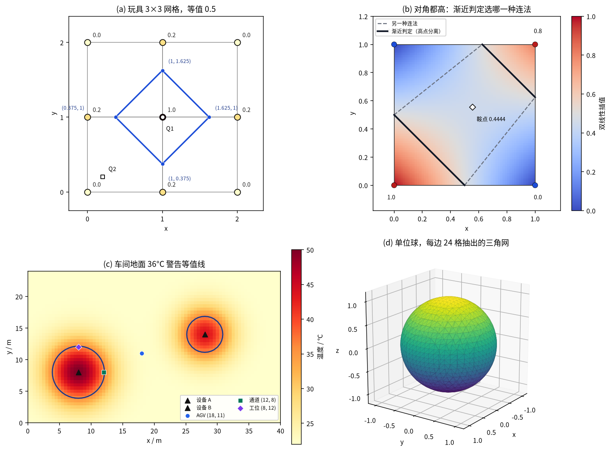

# Marching Cubes

在边长为 2 的正方形窗口里，把 \(3\times 3\) 个格点赋成：中心 1.0，四条边的中点 0.2，四个角 0.0。取等值 0.5，在每条被穿过的格子棱上做线性插值，四条等值线段的端点恰好是 \((1, 0.375)\)、\((0.375, 1)\)、\((1, 1.625)\)、\((1.625, 1)\)。它们围成对角线长都是 1.25 的菱形，面积是 **0.78125**，周长是 \(2.5\sqrt{2}=3.535534\)。中心点 Q1\((1,1)\) 落在菱形内部，角落附近的 Q2\((0.2,0.2)\) 在菱形外部。同一套「看一个格子的角点、在棱上插值、按构型连线」的规则，用到 \(40\,\mathrm{m}\times 24\,\mathrm{m}\) 车间地面的温度场上：设备 A 在 \((8,8)\)，温度为 **50.0** °C；设备 B 在 \((28,14)\)，温度为 **44.000001** °C。36 °C 警告线围出两块互不相连的热区，面积分别是 **53.232410** m² 和 **25.378571** m²，周长合计 **43.762120** m。通道点 \((12,8)\) 的温度是 **36.572605** °C，落在 A 的热区里；位于 \((18,11)\) 的 AGV 只有 **22.378919** °C，在两块热区之外。把同样的想法接到三维，在 \([-1.2,1.2]^3\) 上把每边切成 24 格，提取单位球 \(x^2+y^2+z^2=1\) 的表面，得到 **3608** 个三角形，网格面积 **12.514171**，相对真值 \(4\pi=12.566371\) 偏低 **0.4154%**，顶点到原点的距离与半径 1 最多相差 **0.001247**。读完可以按脚本复现菱形的四个顶点和面积，核对鞍点单元格里渐近判定选出的那一对线段，以及车间里两个测点是否落在 36 °C 等值线之内。

配套演示脚本见交付包 `code/2026-11-17-marching-cubes.py`。下面这张四联图对照玩具网格的菱形等值线、对角高值单元格的两种连法、车间地面的警告等值线，以及单位球抽出的三角网。



图注：图（a）是用来手算核验的 \(3\times 3\) 标量网格，蓝线是等值 0.5 的闭合菱形，白圈 Q1 在内部，白方块 Q2 在外部。图（b）是一个对角为高值的单元格，背景颜色表示双线性插值；实线是渐近判定给出的连法，把两个高角点分成两块，虚线是另一种连法，白色菱形标记是鞍点，函数值约为 0.4444。图（c）是 40 m × 24 m 车间地面的温度，深蓝闭合线是 36 °C 警告等值线，黑色三角是两台设备；绿色方块是通道点，紫色菱形是设备 A 北侧工位，二者都落在左侧热区里，蓝色圆点是 AGV，在两块热区之外。图（d）是把区间 \([-1.2,1.2]\) 每边切成 24 格之后抽出的单位球三角网，网格面积为 12.514171，真值 \(4\pi\) 约为 12.566371。

## 是什么

**Marching Cubes**（常译作移动立方体或行进立方体）从规则三维网格上的标量场里，抽出一张等于给定阈值的三角网格，也就是等值面。William E. Lorensen 和 Harvey E. Cline 在 1987 年的 SIGGRAPH 上发表了这个方法，当时的主要对象是 CT、磁共振这类体数据：把相邻的八个采样点看成一个小立方体，根据八个角点高于还是低于阈值，查一张预先算好的构型表，在被穿过的棱上用线性插值落下顶点，再把这些顶点连成三角形。八个角点各有两种状态，一共 \(2^8=256\) 种构型；用旋转、反射和内外对换，可以压成 15 种基本情形。二维里的对应算法叫 **Marching Squares**（移动正方形）：一个格子四个角点，16 种构型，输出的是等值线线段而不是三角形。

等值面一旦变成三角网，就可以做光照、碰撞检测，也可以导出给引擎或 CAD 使用。这和在着色器里按像素追踪隐式曲面不同：后者得到的是一幅图像，这里得到的是一组顶点与面。

**本文范围：** 规则直角网格、棱上的线性插值，以及可核对的二维演示：玩具 \(3\times 3\) 网格、一个需要判定的鞍点单元格、车间地面温度的 36 °C 等值线；三维则用同一套面上的判定，在有限分辨率下提取单位球，并报告面积误差随格子变细如何下降。**非范围：** Dual Contouring 等更擅长保留尖锐棱的方法、直接做体绘制而不抽网格的方法、非结构网格或四面体剖分上的等值面算法，以及把 256 项三角剖分表整表抄进正文。生产里若需要与三线性插值完全一致的内部拓扑，应改用带内部测试的查找表，而不是本文演示脚本里的扇形剖分。

## 怎么工作

### 先从一个格子的四条边看起

取一个边长为 1 的格子，左下角在 \((i,j)\)，四个角点按「x 向右、y 向上」编号：左下 \(v_{00}\) 占第 0 位，右下 \(v_{10}\) 占第 1 位，右上 \(v_{11}\) 占第 2 位，左上 \(v_{01}\) 占第 3 位。角点值大于或等于阈值记为 1，否则记为 0，四个比特拼成 0 到 15 的构型号。构型为 0 或 15 时，格子完全在等值一侧，没有线段。其余情形里，等值线从一条被穿过的棱走到另一条被穿过的棱。交点位置按线性插值放置：若棱的两端是 \(p_0,v_0\) 和 \(p_1,v_1\)，阈值是 \(c\)，则

\[
t=\frac{c-v_0}{v_1-v_0},\qquad p=p_0+t(p_1-p_0).
\]

玩具例子左下那个格子的四个角值是 0.0、0.2、1.0、0.2，只有右上角高于 0.5，构型号是 4。右棱从 0.2 升到 1.0，交点在 \(t=(0.5-0.2)/(1.0-0.2)=0.375\)，也就是 \((1,0.375)\)；上棱从左侧的 0.2 升到右侧的 1.0，交点同样是 \(t=0.375\)，也就是 \((0.375,1)\)。另外三个格子由对称得到另外三个顶点。四个顶点正好是菱形的四个尖，两条对角线都是 1.25，面积是 \(1.25\times 1.25/2=0.78125\)；每条边长是 \(0.625\sqrt{2}\)，周长是 \(2.5\sqrt{2}\)。

下面这段代码只核对右棱插值、菱形面积和周长，前提是 Python 3；预期输出为 `0.375`、`0.78125`、`3.535534`。

```python
import math

iso = 0.5
t = (iso - 0.2) / (1.0 - 0.2)
print(round(t, 6))

area = 1.25 * 1.25 / 2.0
print(area)

perimeter = 4 * 0.625 * math.sqrt(2.0)
print(round(perimeter, 6))
```

### 对角两个角点都高于阈值时，四种符号不够用

四个角点的符号并不能唯一决定等值线该怎么走。把左下角和右上角设成 1.0 和 0.8，另外两个角设成 0.0，阈值仍取 0.5，四条棱就都会被穿过：底边交于 \((0.5,0)\)，右边交于 \((1,0.625)\)，顶边交于 \((0.625,1)\)，左边交于 \((0,0.5)\)。接下来可以把「左下高区」和「右上高区」分成两块，也可以改连另外一对边，让两个高区在格子里连通。两种连法在四个角点上看都说得通，相邻格子如果各选各的，共享棱上的线段会对不齐，等值线或等值面就会出现裂缝。

格子内部如果用双线性插值

\[
f(x,y)=(1-x)(1-y)v_{00}+x(1-y)v_{10}+xy\,v_{11}+(1-x)y\,v_{01},
\]

临界点处的函数值有闭形式

\[
f_{\mathrm{saddle}}=\frac{v_{00}v_{11}-v_{10}v_{01}}{v_{00}+v_{11}-v_{10}-v_{01}}.
\]

对本例，分子是 0.8，分母是 1.8，鞍点值恰好是 \(4/9=0.444\overline{4}\)。Gregory M. Nielson 和 Bernd Hamann 在 1991 年给出的**渐近判定**（asymptotic decider）把阈值和这个鞍点值比较：阈值高于鞍点时，两个高角点各自成一块，应当把左下的两条棱连在一起、右上的两条棱连在一起；阈值低于鞍点时，选用另一对连法。本例里 0.5 高于 \(4/9\)，所以实线是 \((0.5,0)\)—\((0,0.5)\) 与 \((1,0.625)\)—\((0.625,1)\)。图（b）里的虚线是另一种连法，它会让两个高角点连成一片，和这张双线性插值的 0.5 等高线不一致。

下面两行用来核对鞍点值和判定方向，预期输出为 `0.4444444444444444` 和 `True`。

```python
v00, v10, v11, v01 = 1.0, 0.0, 0.8, 0.0
saddle = (v00 * v11 - v10 * v01) / (v00 + v11 - v10 - v01)
print(saddle)
print(0.5 > saddle)
```

三维立方体的六个面里，只要出现这种「对角交替」，就会碰到同样的面歧义。Martin J. Dürst 在 1988 年已经指出，Lorensen 与 Cline 最初那张由 15 种基本情形展开的表是不完整的。后来的 Marching Cubes 33 以及 Thomas Lewiner、Hélio Lopes、Antônio Wilson Vieira 和 Geovan Tavares 在 2003 年的实现，会在面判定之外再处理立方体内部的隧道型歧义，使得结果和三线性插值的拓扑一致，并且是一张流形网格。

### 把立方体逐个走完，就得到一张三角网

三维步骤和二维是对齐的。对每一个立方体：用八个角点相对阈值的符号拼出一个 0 到 255 的索引；用索引去查哪些棱被等值面穿过；在这些棱上做线性插值得到顶点；再按表把顶点连成三角形。Lorensen 和 Cline 还建议用标量场在格点上的梯度作为法向，沿棱插值后供光照使用。演示脚本没有把 256 项三角剖分表整表写进正文，而是对每个立方体的六个面做带渐近判定的 Marching Squares，把得到的线段收成闭合环，再做扇形剖分。相邻立方体共用同一张面、同一次判定，共享棱上的顶点位置一致，面与面之间不会撕开。单位球这个例子里没有出现需要区分内部隧道的构型；若输入场更不规则，内部歧义仍应交给带完整内部测试的查找表，例如 scikit-image 默认的 Lewiner 实现。

## 复杂度与代价

算法按立方体（或正方形）逐个前进，每个格子的查表和插值是常数时间，总时间与格子数 \(N\) 以及输出的顶点、三角形数量成正比。空格子直接跳过。等值面是二维曲面，三角形数量通常随线性分辨率的平方增长，而不是随体积增长。把单位球所在的 \([-1.2,1.2]^3\) 每边依次切成 8、16、24 格，三角形数分别是 **440**、**1640**、**3608**，大约按 \(2^2\) 和 \(1.5^2\) 放大；网格面积依次是 12.106594、12.447241、12.514171，相对 \(4\pi\) 的偏差从 **−3.6588%** 收到 **−0.9480%**，再收到 **−0.4154%**；顶点半径的最大偏差从 0.011039 收到 0.002816，再收到 0.001247。线性插值相当于用弦去逼近凸曲面，所以这组面积都略小于真值。格子再细，误差还能继续降，顶点和三角形会按平方变多，内存和后续的绘制、碰撞成本也会一起上去。

## 车间地面上的 36 °C 警告等值线

车间地面宽 40 m、深 24 m，环境温度 22 °C，两台设备各自贡献一朵高斯状的热羽。温度场取

\[
T(x,y)=22+28\exp\Bigl(-\frac{(x-8)^2+(y-8)^2}{2\times 3.5^2}\Bigr)+22\exp\Bigl(-\frac{(x-28)^2+(y-14)^2}{2\times 3.0^2}\Bigr).
\]

设备中心正好落在 0.5 m 的采样格点上。A 处是 22 + 28，B 在这个距离上的贡献约为 \(10^{-10}\) °C，所以 A 处温度为 50.0 °C；B 处是 22 + 22，再加上 A 留下的约 \(10^{-6}\) °C，脚本里记成 44.000001 °C。把阈值设为 36 °C，在 80 × 48 个格子上抽出两条互不相连的闭合等值线：包围 A 的那一块面积 53.232410 m²、周长 25.878710 m，包围 B 的那一块面积 25.378571 m²、周长 17.883410 m。A 的热区更大，是因为峰值更高、热羽更宽。

通道点 \((12,8)\) 在连续场上的温度是 36.572605 °C，已经越过警告线；把它代入抽出的多边形做奇偶测试，它落在 A 的那条等值线内部，和场上的判断一致。设备 A 北侧的工位 \((8,12)\) 温度为 36.572603 °C，同样在 A 的热区里——若只有设备 A，这两个点相对 A 是对称的，温度应完全相同，现在差在小数点后第六位附近，来自设备 B 的不对称尾巴。位于两台设备之间的 AGV 点 \((18,11)\) 只有 22.378919 °C，连续场和多边形测试都判定它在热区之外。数字孪生里可以把这样的等值线叠在车间平面图上，用来看人行通道或停放点有没有进到高温区；阈值改成 42 °C 的话，通道点 36.572605 °C 会回到线外，热区会明显收缩。

## 单位球网格，以及可以交给引擎的表面

单位球 \(x^2+y^2+z^2=1\) 的面积是 \(4\pi\)，适合用来衡量网格分辨率够不够。上面已经给出每边 8、16、24 格的面积和半径偏差。24 格时格子边长是 0.1，3608 个三角形已经能看出球面，半径偏差不超过 0.001247，但在曲率高的地方仍然能看到折面。若目标是导出一张可以赋材质、可以做碰撞的网格，这种分辨率往往先够用，再按误差预算加密。Three.js 的 MarchingCubes 示例用的是同一类查找表，常见用法是把若干个 metaball 的密度场即时抽成网格。Unity 里也可以按体素场生成 `Mesh`，再挂到网格碰撞体上。车间三维温度场同样可以抽出 36 °C 的封闭曲面，用来看热区在高度方向上伸到哪里；做法和单位球相同，只是标量场换成温度。

## 局限和要注意的地方

1. **棱上的线性插值并不是非线性场的真零点。** 玩具网格和温度场在格子内部都不是线性的，交点只是端点值的一次比例。场在一个格子里弯曲得越厉害，等值线或等值面相对真值的位置误差越大，要靠把格子划细来压。
2. **只用最初那 15 种基本构型，可能在共享面上选出互相冲突的连法，网格会出现裂缝。** 面歧义要用渐近判定（或等价的、两边共用的规则）来消掉；内部隧道型歧义需要更完整的表，例如 Lewiner 等人 2003 年的实现。
3. **尖锐棱会被切成斜面。** Marching Cubes 把顶点限制在格子棱上，直角、薄壁一类特征会被倒角。要保留尖锐特征，需要改用 Dual Contouring 这类把顶点放到格子内部的方法，那已经超出本文范围。
4. **等值面若和计算窗口的边界相交，得到的就不是封闭曲面。** 单位球例子把窗口留到 1.2，球面没有碰到边界；温度等值线也封闭在车间内部。换一场会伸到窗外的标量场时，要先分清自己要的是封闭壳体，还是允许出现开边界的切片。
5. **演示用的扇形剖分不是通用的三维实现。** 它对单位球这类以单个凸环为主的立方体够用，但不能替代带内部测试的标准查找表。把演示脚本的面积数字拿去和 scikit-image 的 Lewiner 实现对照时，分辨率相同也不保证三角形计数完全一致，因为剖分方式不同；应对照的是网格是否落在同一张等值面附近，以及面积是否一起逼近真值。

## 延伸思考

1. 把玩具网格中心从 1.0 改成 0.6，重新计算四条棱上的 \(t\) 和四个顶点，看菱形是否仍然对称，面积如何变。
2. 把鞍点单元格的阈值改成 0.4，它低于 \(4/9\)，渐近判定应改选另一对连法；在同一张双线性插值图上画出新的实线，确认它与 0.4 的等高线一致。
3. 把车间警告线从 36 °C 改到 42 °C，重算两块热区的面积和周长，并检查通道点 \((12,8)\) 是否已经落到线外。
4. 用同一套单位球设置，把每边格数改成 12 和 32，把面积相对误差、最大半径偏差和三角形数量记下来，看它们是否大致按线性分辨率的平方与一次方变化。
5. 把球的标量场从 \(1-(x^2+y^2+z^2)\) 改成 \(1-\sqrt{x^2+y^2+z^2}\)，再抽一次 24 格的网格，比较顶点半径偏差，体会「在棱上线性插值的是哪一个函数」会改变交点位置。

## 参考文献

1. [William E. Lorensen, Harvey E. Cline, “Marching cubes: A high resolution 3D surface construction algorithm,” ACM SIGGRAPH Computer Graphics 21(4):163–169, 1987.](https://doi.org/10.1145/37402.37422)
2. [ACM SIGGRAPH History Archives, “Marching cubes: A high resolution 3D surface construction algorithm” by Lorensen and Cline.](https://history.siggraph.org/learning/marching-cubes-a-high-resolution-3d-surface-construction-algorithm-by-lorensen-and-cline/)
3. [Martin J. Dürst, “Re: Additional reference to ‘marching cubes’,” ACM SIGGRAPH Computer Graphics 22(5):243, 1988.](https://doi.org/10.1145/378267.378271)
4. [Gregory M. Nielson, Bernd Hamann, “The asymptotic decider: resolving the ambiguity in marching cubes,” Proceedings of Visualization ’91, pp. 83–91, 1991.](https://doi.org/10.1109/visual.1991.175782) 公开稿：[eScholarship](https://escholarship.org/uc/item/17p025zk)
5. [Thomas Lewiner, Hélio Lopes, Antônio Wilson Vieira, Geovan Tavares, “Efficient implementation of Marching Cubes’ cases with topological guarantees,” Journal of Graphics Tools 8(2):1–15, 2003.](https://doi.org/10.1080/10867651.2003.10487582) 作者自存档：[PDF](https://thomas.lewiner.org/pdfs/marching_cubes_jgt.pdf)
6. [Paul Bourke, “Polygonising a scalar field (Marching Cubes),” 1994.](https://paulbourke.net/geometry/polygonise/)
7. [Marching cubes — Wikipedia](https://en.wikipedia.org/wiki/Marching_cubes)
8. [Marching squares — Wikipedia](https://en.wikipedia.org/wiki/Marching_squares)
9. [skimage.measure.marching_cubes — scikit-image documentation](https://scikit-image.org/docs/stable/api/skimage.measure.html#skimage.measure.marching_cubes)
10. [Marching Cubes example — scikit-image](https://scikit-image.org/docs/stable/auto_examples/edges/plot_marching_cubes.html)
11. [Three.js Marching Cubes example](https://threejs.org/examples/#webgl_marchingcubes)
12. [three.js MarchingCubes.js source](https://github.com/mrdoob/three.js/blob/dev/examples/jsm/objects/MarchingCubes.js)
13. [William E. Lorensen, “History of the Marching Cubes Algorithm,” IEEE Computer Graphics and Applications 40(2):8–15, 2020.](https://doi.org/10.1109/MCG.2020.2971284)
