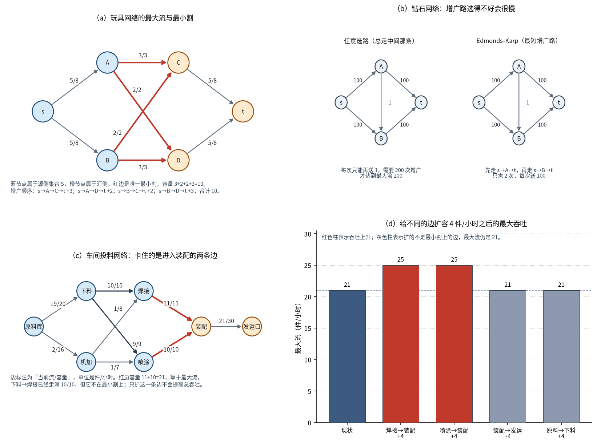

# 最大流最小割

在六节点玩具网络里，源点 \(s\) 到 \(A\)、\(B\) 的容量各是 8，\(A\) 到 \(C\)、\(D\) 的容量是 3 和 2，\(B\) 到 \(C\)、\(D\) 的容量是 2 和 3，\(C\)、\(D\) 到汇点 \(t\) 的容量各是 8。用广度优先搜索反复寻找边数最少的增广路，并固定邻居按 \(s,A,B,C,D,t\) 的顺序展开，四次分别沿 \(s\rightarrow A\rightarrow C\rightarrow t\)、\(s\rightarrow A\rightarrow D\rightarrow t\)、\(s\rightarrow B\rightarrow C\rightarrow t\)、\(s\rightarrow B\rightarrow D\rightarrow t\) 送出 3、2、2、3，得到最大流 **10**。残量网络里仍能从 \(s\) 走到的点只有 \(\{s,A,B\}\)，从这一侧跨到另一侧的四条边容量之和是 \(3+2+2+3=\)**10**，与最大流相等；把全部 \(s\)-\(t\) 割枚举一遍之后，没有容量更小的割。这组流里，\(s\rightarrow A\) 与 \(s\rightarrow B\) 各为 5/8，中间四条边全部走满，\(C\rightarrow t\) 与 \(D\rightarrow t\) 各为 5/8。同一套规则用到车间投料网上：原料库到下料、机加的容量是 20 和 16，下料到焊接、喷涂是 10 和 9，机加到焊接、喷涂是 8 和 7，焊接、喷涂进入装配是 11 和 10，装配到发运口是 30，单位都是件/小时。最大流是 **21** 件/小时，唯一最小割就是进入装配的那两条边，容量 \(11+10=21\)。把其中任意一条扩容 4，最大流升到 **25**；把装配到发运口或原料库到下料扩容 4，最大流仍是 **21**。喷涂整站停机后最大流降到 **11**，焊接整站停机后降到 **10**。若在「钻石」网络里两侧容量都是 100、中间再加一条容量为 1 的边，最短增广路只需 **2** 次就能送到最大流 200；如果总是优先走经过中间那条边的长路，则要增广 **200** 次，每次只能再送 1。读完可以按脚本复现玩具网络的四次增广和最小割，核对车间里哪两条边卡住了吞吐，以及钻石网络两种选路的增广次数。

配套演示脚本见交付包 `code/2026-11-19-maxflow-mincut.py`。下面这张四联图对照玩具网络的最大流与最小割、钻石网络上两种增广路选择的次数差异、车间投料网里卡住吞吐的边，以及给不同边扩容之后的最大流。



图注：图（a）是六节点玩具网络，边上的数字是「当前流/容量」。蓝色节点属于源侧集合 \(S=\{s,A,B\}\)，橙色节点属于汇侧；红色边是唯一最小割，容量之和等于最大流 10。图（b）是两侧容量为 100、中间多一条容量为 1 的钻石网络：若总走经过中间边的长路，需要 200 次增广才能达到最大流 200；用广度优先搜索选最短增广路，只需 2 次。图（c）是车间投料网，单位是件/小时，红色边是进入装配的两条边，容量 \(11+10=21\)，等于最大流；下料到焊接虽然已经走满 10/10，但不在最小割上。图（d）把四条边各自扩容 4 件/小时：扩焊接到装配或喷涂到装配，最大流升到 25；扩装配到发运口或原料库到下料，最大流仍是 21。

## 是什么

**最大流**问题问的是：在一张每条边都带非负容量的有向网络里，从源点 \(s\) 到汇点 \(t\)，最多能稳定送出多少流。一份可行流要满足两条约束。容量约束要求每条边上的流量不超过该边容量；流守恒要求除了 \(s\) 和 \(t\) 以外，每个点的流入等于流出，既不积压也不凭空产生。最大流的值等于从 \(s\) 净流出的总量，也等于净流入 \(t\) 的总量。

一个 **\(s\)-\(t\) 割**把节点分成两块，使得 \(s\) 在源侧集合 \(S\) 里，\(t\) 在另一侧。割的容量是所有从 \(S\) 指向外侧的边的容量之和。任何一份可行流的值都不会超过任何一个割的容量，因为能从源侧送到汇侧的流量，过不去这些跨侧边。Ford 与 Fulkerson 在 1956 年证明：最大流的值等于容量最小的那个 \(s\)-\(t\) 割，这就是 **最大流最小割定理**。同年 Elias、Feinstein 与 Shannon 也独立得到了这个等式。定理不只给出一个数字，还指出「卡在哪里」：最小割上的那些边，就是把吞吐顶住的那一批通道。

求最大流的经典做法是增广路方法：从零流开始，在还能继续往前送的残量网络里找一条 \(s\) 到 \(t\) 的路，按这条路上最窄的残量把流加大，直到找不到这样的路为止。如果每次都选边数最少的增广路，增广次数就有多项式上界。Edmonds 与 Karp 在 1972 年发表了这一分析；Yefim Dinitz（也常写作 Dinic）在 1970 年已经独立采用最短增广路，并进一步用分层网络和阻塞流把时间降到 \(O(|V|^2|E|)\)。下文实现的是用广度优先搜索寻找最短增广路的那一版，也就是现在常称为 **Edmonds-Karp 算法**的做法，不实现阻塞流。

**本文范围：** 单源单汇、有向边、非负整数容量，以及可按固定邻居顺序复现的 Edmonds-Karp；用玩具网络手算四次增广并枚举核对最小割，用钻石网络对照「选路不当」时的增广次数，再用车间投料网做扩容和停机对照。**非范围：** 带费用的最小费用流、多种物料同时争用通道的多商品流、Dinitz 阻塞流或预流推进的完整实现，以及用图割做图像分割的完整流程。无向边若要纳入计算，需要先按容量约定拆成双向有向边，本文演示网络都按有向边给出。

## 怎么工作

### 残量网络和一次增广

把当前已经占用的流量从容量里减去，就得到还能继续使用的**残量**。如果一条边上已经有流量 \(f\)，这条边的正向残量是容量减去 \(f\)；同时要给反向补上大小为 \(f\) 的残量，以便后面发现走错时可以把流退回去。所有残量为正的边组成**残量网络**。残量网络里一条从 \(s\) 到 \(t\) 的路叫做**增广路**，路上最小的残量就是这次还能再送的增量。

### 玩具网络上的四次最短增广

Edmonds-Karp 用广度优先搜索在残量网络里找增广路，因此每次找到的都是边数最少的一条；如果有多条同样短的路，本文按节点顺序 \(s,A,B,C,D,t\) 展开邻居，顺序就固定下来。从零流开始，四次增广如下。

1. 最短路是 \(s\rightarrow A\rightarrow C\rightarrow t\)，残量是 8、3、8，增量是 3。\(A\rightarrow C\) 被送满。
2. 下一条最短路是 \(s\rightarrow A\rightarrow D\rightarrow t\)，残量是 5、2、8，增量是 2。\(A\rightarrow D\) 被送满。此时从 \(s\) 经 \(A\) 出发的两条前进边都已经饱和。
3. 下一条是 \(s\rightarrow B\rightarrow C\rightarrow t\)，残量是 8、2、5，增量是 2。\(B\rightarrow C\) 被送满。
4. 最后一条是 \(s\rightarrow B\rightarrow D\rightarrow t\)，残量是 6、3、6，增量是 3。\(B\rightarrow D\) 被送满。累计流量 \(3+2+2+3=10\)。

此后残量网络里不再有从 \(s\) 到 \(t\) 的路。得到的边流是：\(s\rightarrow A\) 与 \(s\rightarrow B\) 各 5/8，中间四条边 3/3、2/2、2/2、3/3，\(C\rightarrow t\) 与 \(D\rightarrow t\) 各 5/8。最大流的值是唯一的，边上如何分流却不一定只有这一种写法；这里记录的是按上述邻居顺序跑 Edmonds-Karp 得到的那一份。中间节点满足流守恒：\(A\) 的流入 5 等于流出 \(3+2\)，\(B\) 同样是 \(5=2+3\)，\(C\) 与 \(D\) 都是 \(5=5\)。

下面这段代码只核对四次增量之和，以及最小割四条边的容量之和，前提是 Python 3；预期输出为两行 `10`。

```python
deltas = [3, 2, 2, 3]
print(sum(deltas))

cut_caps = [3, 2, 2, 3]
print(sum(cut_caps))
```

完整的广度优先搜索、残量更新和割枚举见交付包脚本。脚本还会用枚举出的最小割容量与算法得到的最大流对照，并检查每个中间节点的流入是否等于流出。

### 从残量里读出最小割

增广结束时，在残量网络里从 \(s\) 能到达的点组成源侧集合 \(S\)。本例中 \(S=\{s,A,B\}\)，另一侧是 \(\{C,D,t\}\)。所有从 \(S\) 指向外侧的边是 \(A\rightarrow C\)、\(A\rightarrow D\)、\(B\rightarrow C\)、\(B\rightarrow D\)，容量之和是 10，正好等于最大流。对六个节点里除 \(s\)、\(t\) 以外的四个点做全集枚举，容量为 10 的 \(s\)-\(t\) 割只有这一个；源点出边之和是 16，汇点入边之和也是 16，都比 10 大，卡住吞吐的是中间那一层，而不是出入口本身。

这个读法同时给出定理的一个方向：残量里已经没有 \(s\) 到 \(t\) 的路，说明任何额外的流都无法再离开 \(S\)，因此当前流量已经达到了这个割的容量，也就达到了最大流。

### 为什么要用广度优先搜索

Ford-Fulkerson 方法并不规定怎样找增广路。如果选路不得法，即使容量是整数，也可能每次只再送 1，总次数跟最大流的值一样大。钻石网络是常用的对照：\(s\rightarrow A\)、\(s\rightarrow B\)、\(A\rightarrow t\)、\(B\rightarrow t\) 的容量都是 100，再在 \(A\) 与 \(B\) 之间加一条容量为 1 的边。最大流是 200，两条短路 \(s\rightarrow A\rightarrow t\) 和 \(s\rightarrow B\rightarrow t\) 各送 100 就够了。可是如果反复走 \(s\rightarrow A\rightarrow B\rightarrow t\) 和它的反向退流 \(s\rightarrow B\rightarrow A\rightarrow t\)，每次增量都是 1，需要 200 次才能送满。Edmonds-Karp 用广度优先搜索，会先走那两条边数为 2 的短路，增广次数是 2。

## 复杂度与代价

一次广度优先搜索的时间与残量网络的规模成正比，是 \(O(|V|+|E|)\)。Edmonds 与 Karp 证明，每次增广之后，任意一条被送满的关键边，它的起点到源点的最短距离会严格增加，因此每条边成为关键边的次数不超过 \(O(|V|)\)，增广次数不超过 \(O(|V||E|)\)。总时间是 \(O(|V||E|^2)\)。额外空间主要用来存残量，通常按每条原边同时保留正反向，规模仍是 \(O(|V|+|E|)\)。

整数容量时，每次增广至少使流量加 1，增广次数也不会超过最大流的值。钻石网络说明：这个整数上界可以和最大流一样大；改成最短增广路之后，次数不再跟着容量绝对值一起膨胀。网络变得很大时，\(O(|V||E|^2)\) 往往偏慢，生产代码里更常见的是 Dinitz 算法或预流推进一类方法。本文的两个例子分别只有 6 个和 7 个节点，用 Edmonds-Karp 可以直接把每一步写下。

## 应用场景

凡是「通道有容量上限，要问从一端到另一端最多能过多少，以及哪一批通道把这个上限卡住」的问题，都可以先建成容量网络。车间里是工序与传送之间的件数上限；交通或管道里是路段与管段的通过能力；通信里是链路带宽。数字孪生里可以把当前观测到的容量写到边上，先算出现有最大吞吐，再对扩容、检修或停机做对照，而不必先改物理产线。二部图匹配也可以化成最大流，但指派问题本身通常会直接用匈牙利算法一类专用方法。计算机视觉里还有把图像分割写成最小割的做法，本文不展开。

## 车间投料网络：找出卡住吞吐的边

车间网络有 7 个节点：原料库、下料、机加、焊接、喷涂、装配和发运口。边的容量（件/小时）是：原料库到下料 20、到机加 16；下料到焊接 10、到喷涂 9；机加到焊接 8、到喷涂 7；焊接到装配 11、喷涂到装配 10；装配到发运口 30。邻居顺序固定为原料库、下料、机加、焊接、喷涂、装配、发运口。

Edmonds-Karp 同样增广四次：原料库→下料→焊接→装配→发运口送出 10，原料库→下料→喷涂→装配→发运口送出 9，原料库→机加→焊接→装配→发运口送出 1，原料库→机加→喷涂→装配→发运口送出 1，合计 **21**。边流是：原料库到下料 19/20、到机加 2/16；下料到焊接 10/10、到喷涂 9/9；机加到焊接 1/8、到喷涂 1/7；焊接到装配 11/11、喷涂到装配 10/10；装配到发运口 21/30。中间节点守恒：下料 \(19=10+9\)，机加 \(2=1+1\)，焊接 \(11=10+1\)，喷涂 \(10=9+1\)，装配 \(21=11+10\)。

残量里从原料库能走到的点是原料库、下料、机加、焊接和喷涂，到不了装配和发运口。跨过这一分界的边只有焊接→装配和喷涂→装配，容量 \(11+10=21\)。枚举全部割之后，这也是唯一的最小割。入口合计容量 36，出口容量 30，都不是限制因素。

下料到焊接已经走满 10/10，看起来像「堵点」，但它并不在最小割上。焊接到装配的容量是 11，其中 10 已经来自下料，机加还另有余量可以再向焊接送 1；只把下料到焊接再扩宽，多出来的量仍然过不了焊接进入装配的那条边，总吞吐不会增加。要提高 21 这个数字，需要扩最小割上的边：把焊接→装配从 11 改到 15，或把喷涂→装配从 10 改到 14，最大流都升到 **25**，新的最小割仍然是这两条进入装配的边，容量变成 25。若只把装配→发运口从 30 改到 34，或只把原料库→下料从 20 改到 24，最大流仍是 **21**。

把对照再转到停机。喷涂整站退出（下料→喷涂、机加→喷涂、喷涂→装配的容量都改为 0）后，最大流降到 **11**，只剩下焊接进入装配的那条边。焊接整站退出后，最大流降到 **10**，只剩下喷涂进入装配的那条边。这些数字回答的是稳态容量下「现在最多能过多少、扩哪一条才有用、某站停了还剩多少」，并不模拟在制品排队、换型时间或随机故障过程。

## 局限和要注意的地方

最大流的值是唯一的，最小割的容量也是唯一的，但给出同一最大流的边流可以不唯一，最小割对应的节点划分也可以不唯一。本文两个主例子里最小割都只有一个，这是这两个网络的性质，不是一般结论。边上走满只说明这条边的残量为零，不能单独据此判断它属于最小割；车间里下料到焊接就是一个反例。

模型把每条边写成一个与时间无关的容量。真实产线会有班次、换型、缓存和故障，数字孪生里应当把这些因素先折进当时的有效容量，或者改用带时间层的网络，再来求流。单品种、无费用的设定也回答不了「同样送 21 件，怎样更省运输成本」，那是最小费用流的问题；两条以上物料同时争用同一通道，则是多商品流，不能把它们的流量直接加在同一条边上当成一种流来求。

## 延伸思考

1. 把玩具网络里 \(A\rightarrow C\) 的容量从 3 改成 5，按同一邻居顺序重跑 Edmonds-Karp，确认最大流变为 12，并写出新的源侧集合与跨侧边。
2. 只把玩具网络里 \(C\rightarrow t\) 的容量从 8 改成 4，重算最大流和最小割；看最小割是否仍然只由中间那四条边组成。
3. 把车间里下料→焊接的容量从 10 改到 14，确认最大流仍是 21，并用残量可达性说明这条边为什么不是最小割上的边。
4. 同时把焊接→装配和喷涂→装配各扩容 2，使两条割边变成 13 和 12。先估计最大流，再跑脚本核对；看新的最小割是否仍是这两条边。
5. 在玩具网络第一次增广（\(s\rightarrow A\rightarrow C\rightarrow t\) 送出 3）之后，写出当时各边的正向残量和反向残量，确认 \(C\rightarrow A\) 的反向残量是 3，并想一条以后可能用到这条反向边的增广路。

## 参考文献

1. [L. R. Ford, Jr., D. R. Fulkerson, “Maximal flow through a network,” Canadian Journal of Mathematics 8:399–404, 1956.](https://doi.org/10.4153/cjm-1956-045-5) 公开 PDF：[Yale CS copy](https://cs.yale.edu/homes/lans/readings/routing/ford-max_flow-1956.pdf)
2. [P. Elias, A. Feinstein, C. E. Shannon, “A note on the maximum flow through a network,” IRE Transactions on Information Theory 2(4):117–119, 1956.](https://doi.org/10.1109/TIT.1956.1056816)
3. [Jack Edmonds, Richard M. Karp, “Theoretical improvements in algorithmic efficiency for network flow problems,” Journal of the ACM 19(2):248–264, 1972.](https://doi.org/10.1145/321694.321699)
4. [Yefim Dinitz, “Dinitz’ Algorithm: The Original Version and Even’s Version,” in Theoretical Computer Science: Essays in Memory of Shimon Even, Springer, pp. 218–240, 2006.](https://www.cs.bgu.ac.il/~dinitz/Papers/Dinitz_alg.pdf) 这篇综述回溯 1970 年原文：E. A. Dinic, “Algorithm for solution of a problem of maximum flow in a network with power estimation,” Soviet Mathematics Doklady 11:1277–1280, 1970.
5. [Jeff Erickson, “Maximum Flows & Minimum Cuts,” in Algorithms, Chapter 10.](https://jeffe.cs.illinois.edu/teaching/algorithms/book/10-maxflow.pdf)
6. [Thomas H. Cormen, Charles E. Leiserson, Ronald L. Rivest, Clifford Stein, Introduction to Algorithms, 3rd ed., Chapter 26, MIT Press, 2009.](https://mitpress.mit.edu/9780262033848/introduction-to-algorithms/)
7. [Max-flow min-cut theorem — Wikipedia](https://en.wikipedia.org/wiki/Max-flow_min-cut_theorem)
8. [Edmonds–Karp algorithm — Wikipedia](https://en.wikipedia.org/wiki/Edmonds%E2%80%93Karp_algorithm)
9. [Ford–Fulkerson algorithm — Wikipedia](https://en.wikipedia.org/wiki/Ford%E2%80%93Fulkerson_algorithm)
10. [networkx.algorithms.flow.edmonds_karp — NetworkX documentation](https://networkx.org/documentation/stable/reference/algorithms/generated/networkx.algorithms.flow.edmonds_karp.html)
11. [Edmonds-Karp algorithm — CP-Algorithms](https://cp-algorithms.com/graph/edmonds_karp.html)
